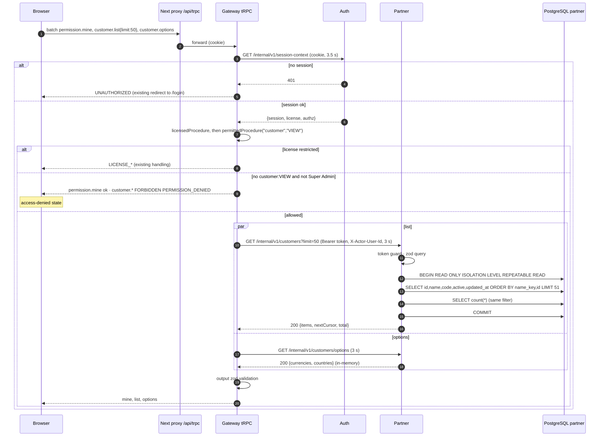
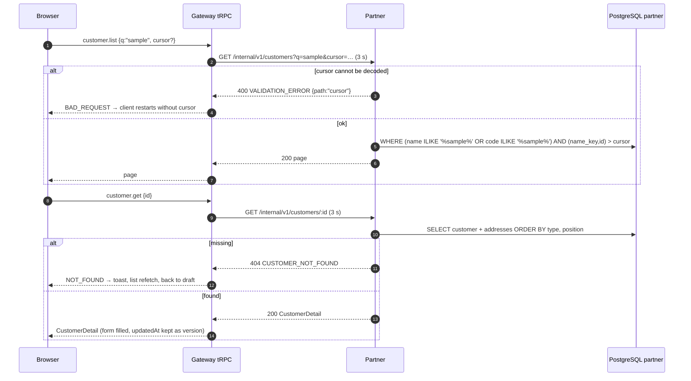
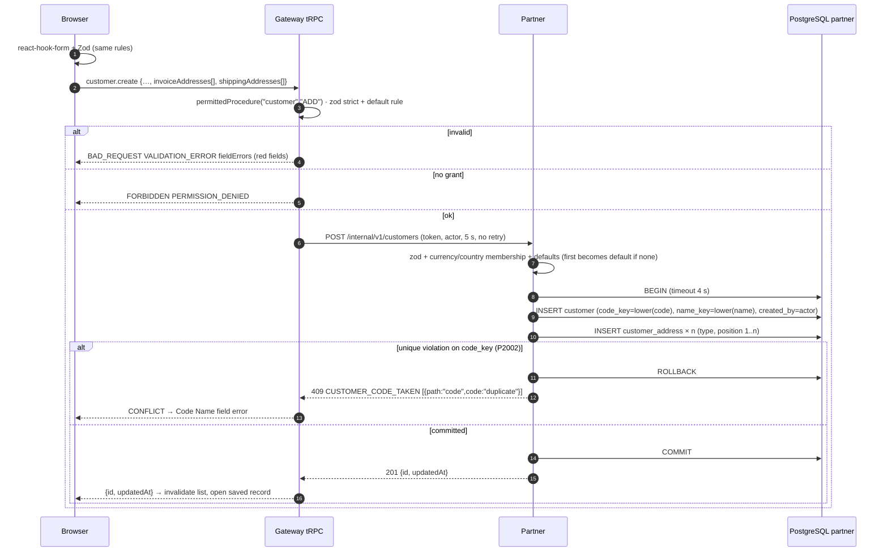
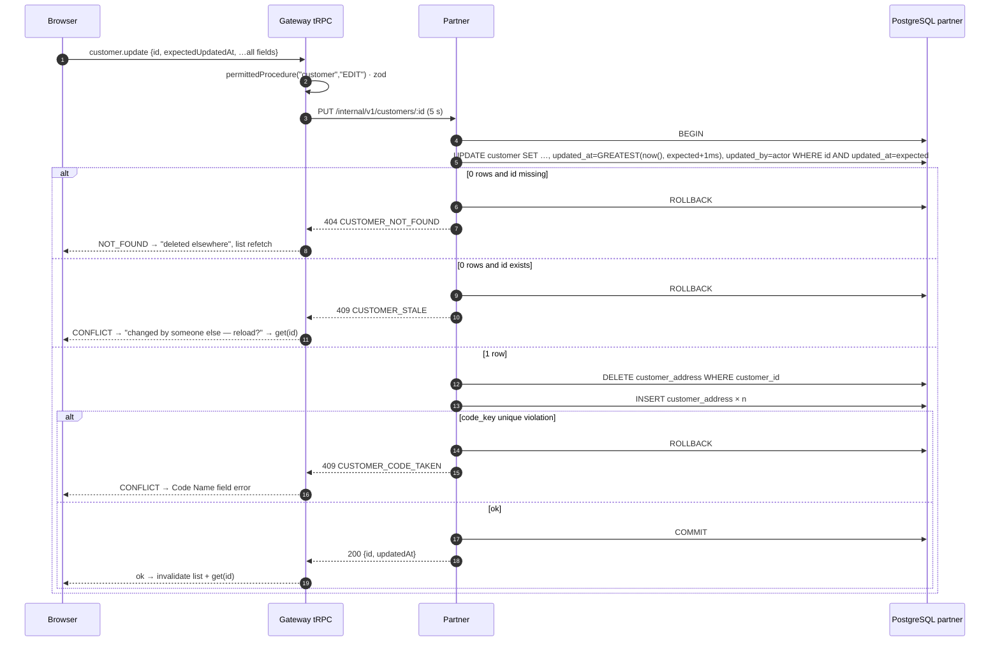
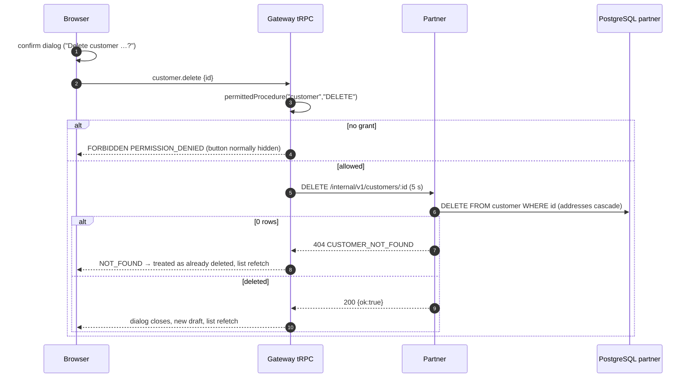

# Sequence diagram: partner + gateway / customer

- Source UI revision / SA revision: 1 / 1 (pending-review)
- Main user flow: [customer-flow.md](../../../../diagram/customer-flow.md)
- Related API operations / TODO IDs: [API contract](api-contract.md); BE-CUS-001…015; consuming `FE-CUS-*` ([central TODO](../../../../task/todo/customer.md))
- Participants: Browser (Next.js `/setup/customer`) → Next proxy `/api/trpc` → Gateway (NestJS + tRPC) → Auth (session-context only, unchanged) → Partner (NestJS) → PostgreSQL schema `partner`

## 1. Page load: context, permission, list and options



## 2. Search, page and open a customer



## 3. Create customer



## 4. Update customer (whole replacement, optimistic concurrency)



## 5. Delete customer (hard)



## 6. Partner unavailable, timeout or token mismatch

```mermaid
sequenceDiagram
    autonumber
    participant B as Browser
    participant G as Gateway tRPC
    participant S as Partner
    B->>G: any customer.* call (permission already passed)
    G->>S: request (3 s read / 5 s write)
    alt connection refused / DNS / timeout
        G-->>B: SERVICE_UNAVAILABLE PARTNER_UNAVAILABLE (no retry)
        Note over B: reads: query client may retry; mutations: refresh list before re-submitting
    else 401 from partner (token wrong or missing)
        G->>G: log error "partner rejected service token" (no token value)
        G-->>B: SERVICE_UNAVAILABLE PARTNER_UNAVAILABLE (never UNAUTHORIZED)
    else 5xx from partner
        G-->>B: 503 → PARTNER_UNAVAILABLE · 500 → INTERNAL_SERVER_ERROR
    else malformed or oversize (> 1 MiB) response
        G-->>B: SERVICE_UNAVAILABLE PARTNER_UNAVAILABLE
    end
```
