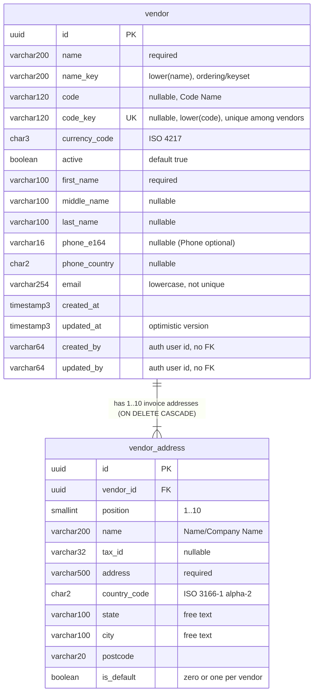
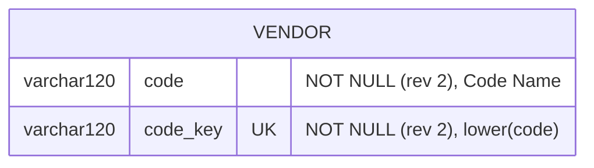

# Database diagram: partner / vendor

- Source UI revision / SA revision: 3 / **2** (ADR-0021, see [Revision 2](#revision-2--adr-0021-implemented-2026-10-16)); revision 1 (2 / 1) implemented 2026-10-15
- Owning service / schema: `backend-api-partner` / PostgreSQL schema `partner` in database `f1_system`
- Actual Prisma schema / migration paths: `backend-api-partner/prisma/schema.prisma` (existing, extended), new `backend-api-partner/prisma/migrations/<YYYYMMDDHHMMSS>_vendor/migration.sql` (timestamp after `20261014120000_customer`). Integration-owned path `backend-api-partner/prisma/**`: backend is the single writer, parent serializes.
- Migrations table: `partner._prisma_migrations` (existing; D-01 of customer unchanged)
- Existing affected model: none. `customer`, `customer_address` and enum `address_type` are **not altered**.

Everything below is **NEW**. No `auth`/`public` change, no cross-schema FK, no relation to `customer`.



## Prisma proposal (added to the existing schema)

```prisma
model Vendor {
  id           String          @id @default(uuid()) @db.Uuid
  name         String          @db.VarChar(200)
  nameKey      String          @map("name_key") @db.VarChar(200)
  code         String?         @db.VarChar(120)
  codeKey      String?         @unique(map: "vendor_code_key_key") @map("code_key") @db.VarChar(120)
  currencyCode String          @map("currency_code") @db.Char(3)
  active       Boolean         @default(true)
  firstName    String          @map("first_name") @db.VarChar(100)
  middleName   String?         @map("middle_name") @db.VarChar(100)
  lastName     String?         @map("last_name") @db.VarChar(100)
  phoneE164    String?         @map("phone_e164") @db.VarChar(16)
  phoneCountry String?         @map("phone_country") @db.Char(2)
  email        String          @db.VarChar(254)
  createdAt    DateTime        @default(now()) @map("created_at") @db.Timestamp(3)
  /// Optimistic version; written explicitly by the service (customer D-05), not @updatedAt.
  updatedAt    DateTime        @default(now()) @map("updated_at") @db.Timestamp(3)
  createdBy    String          @map("created_by") @db.VarChar(64)
  updatedBy    String          @map("updated_by") @db.VarChar(64)
  addresses    VendorAddress[]

  @@index([nameKey, id], map: "vendor_name_key_id_idx")
  @@index([active, nameKey, id], map: "vendor_active_name_key_id_idx")
  @@map("vendor")
  @@schema("partner")
}

/// Invoice addresses only (ADR-0019 §3); no `type` column.
model VendorAddress {
  id          String  @id @default(uuid()) @db.Uuid
  vendorId    String  @map("vendor_id") @db.Uuid
  position    Int     @db.SmallInt
  name        String  @db.VarChar(200)
  taxId       String? @map("tax_id") @db.VarChar(32)
  address     String  @db.VarChar(500)
  countryCode String  @map("country_code") @db.Char(2)
  state       String  @db.VarChar(100)
  city        String  @db.VarChar(100)
  postcode    String  @db.VarChar(20)
  isDefault   Boolean @default(false) @map("is_default")
  vendor      Vendor  @relation(fields: [vendorId], references: [id], onDelete: Cascade)

  @@unique([vendorId, position], map: "vendor_address_position_key")
  /// Zero or one default per vendor; a partial UNIQUE index allows zero rows.
  @@unique([vendorId], where: { isDefault: true }, map: "vendor_address_one_default_key")
  @@map("vendor_address")
  @@schema("partner")
}
```

The `partialIndexes` preview feature is already enabled in the generator (customer D-03, verified with an empty
`migrate diff`). **Fallback (same as customer D-03):** if the diff is not empty after generation, drop the `where:`
unique from the schema and add
`CREATE UNIQUE INDEX vendor_address_one_default_key ON "partner"."vendor_address"(vendor_id) WHERE is_default;`
to the migration, with a schema comment that later migrations must keep it.

### Raw SQL CHECKs appended to the migration

```sql
ALTER TABLE "partner"."vendor"
  ADD CONSTRAINT "vendor_name_key_chk"      CHECK ("name_key" = lower("name")),
  ADD CONSTRAINT "vendor_code_key_chk"      CHECK (("code" IS NULL AND "code_key" IS NULL) OR "code_key" = lower("code")),
  ADD CONSTRAINT "vendor_code_nonblank_chk" CHECK ("code" IS NULL OR length(btrim("code")) > 0),
  ADD CONSTRAINT "vendor_currency_chk"      CHECK ("currency_code" ~ '^[A-Z]{3}$'),
  ADD CONSTRAINT "vendor_email_lower_chk"   CHECK ("email" = lower("email")),
  ADD CONSTRAINT "vendor_phone_chk"         CHECK (("phone_e164" IS NULL) = ("phone_country" IS NULL)
    AND ("phone_e164" IS NULL OR "phone_e164" ~ '^\+[1-9][0-9]{6,14}$')
    AND ("phone_country" IS NULL OR "phone_country" ~ '^[A-Z]{2}$'));

ALTER TABLE "partner"."vendor_address"
  ADD CONSTRAINT "vendor_address_position_chk" CHECK ("position" BETWEEN 1 AND 10),
  ADD CONSTRAINT "vendor_address_country_chk"  CHECK ("country_code" ~ '^[A-Z]{2}$');
```

There is no tax-ID-by-type CHECK (every vendor address is an invoice address). The 1..10 count per vendor is an
application rule (zod); the position CHECK plus the `(vendor_id, position)` unique bound it to 10 in the database too.

## Constraints, indexes, bounds

| Object | Purpose |
|---|---|
| `vendor_pkey (id)` | get/update/delete by id |
| `vendor_code_key_key UNIQUE (code_key)` | case-insensitive Code Name uniqueness among vendors; rev 2: `code`/`code_key` NOT NULL |
| `vendor_name_key_id_idx (name_key, id)` | list order + keyset cursor |
| `vendor_active_name_key_id_idx (active, name_key, id)` | list with `active` filter |
| `vendor_address_pkey (id)` | — |
| `vendor_address_position_key UNIQUE (vendor_id, position)` | stable order; serves FK lookups and cascade |
| `vendor_address_one_default_key UNIQUE (vendor_id) WHERE is_default` | at most one default; zero allowed |
| FK `vendor_address.vendor_id → vendor.id ON DELETE CASCADE ON UPDATE CASCADE` | hard delete removes addresses |

- Bounds in code: 1–10 addresses per vendor; list `limit` ≤ 50; search ≤ 100 chars.
- Contains-search `ILIKE` on `name`/`code` is a sequential scan by design (customer D-07).
- `timestamp(3)` UTC; UUID v4 from Prisma; no money fields; `created_by`/`updated_by` are opaque auth user IDs.

## Migration, backfill, compatibility, rollback

1. **Generation:** backend runs `prisma migrate dev --create-only --name vendor` with the partner config against the
   dev DB (never production), appends the CHECKs, then verifies `prisma migrate diff` is empty (BT-VEN-01).
2. **Content (additive only):** two `CREATE TABLE`, five indexes, one FK, eight CHECKs, all in schema `partner`.
   No `ALTER`/`DROP` on `customer`, `customer_address`, `address_type`; review the generated SQL for any such line
   (especially a `DROP INDEX customer_address_one_default_key`) and stop if present.
3. **Backfill:** none.
4. **Order / apply:** partner start-up `prisma migrate deploy` (existing path) as the schema owner; the shared Prisma
   advisory lock with auth behaves as already accepted for customer.
5. **Compatibility:** previous partner/gateway versions ignore the new tables. Auth's Prisma project lists only `auth`.
6. **Rollback:** redeploy previous images; tables stay (harmless). Expected: the previous image's `migrate deploy`
   only applies its own pending migrations and leaves the extra applied `…_vendor` row alone — confirmed on a scratch
   database by BT-VEN-20 before relying on it. Full removal only on an explicit owner decision, via a new forward
   migration (`DROP TABLE "partner"."vendor_address"; DROP TABLE "partner"."vendor";`) after
   `pg_dump --schema=partner`. Prisma has no down migrations.
7. `prisma generate` runs in build/typecheck and the dev image as today; never hand-edit `src/generated/prisma`.

## Revision 2 — ADR-0021 (implemented 2026-10-16)

- Approval: [ADR-0021](../../../../adr/0021-partner-code-running-number-and-record-modes.md), owner 2026-10-16 (ADR-0021 Approval evidence, ending "ทำ adr เเล้วเริ่มทำเลย").
- Migration: `backend-api-partner/prisma/migrations/20261016090000_partner_code_required/migration.sql` (hand-written,
  `prisma migrate dev --create-only` style; one file for customer **and** vendor). Prisma schema: `code String` and
  `codeKey String` (were `String?`) on both models.
- Changed columns on `partner.vendor`: `code varchar(120) NOT NULL`, `code_key varchar(120) NOT NULL` (still `UNIQUE (code_key)`
  via `vendor_code_key_key`; `code_key = lower(code)`). No other table, index or CHECK changes. The existing
  `vendor_code_key_chk` / `vendor_code_nonblank_chk` CHECKs are kept; their `IS NULL` branches are now unreachable.



**Backfill (step 1 of the migration, no data loss):** rows with `code IS NULL` get, in `ORDER BY created_at, id`,
`'V' || lpad(n, 3, '0')` (no truncation above 999: `V1000`), `n = base + row_number()`, where `base` = max numeric suffix
of existing codes matching `^[Vv][0-9]+$` with ≤ 18 significant digits (else 0) — the same rule as
`GET /internal/v1/vendors/next-code`. `code_key = lower(code)`. `updated_at`/`updated_by` are left unchanged (not a user edit).
Generated numbers are larger than every counted code, so they cannot collide with an existing `code_key`.
**Step 2:** `ALTER COLUMN code SET NOT NULL, ALTER COLUMN code_key SET NOT NULL`.
The partner container runs `migrate deploy` before serving (single instance), so no concurrent insert races the backfill.

**Verification:** scratch database (`f1_adr0021_scratch`, dropped afterwards) with rows `C005`, `c010`, a 24-digit `C…` code,
`CM01` and three NULL codes → `C011`, `C012`, `C013` in `created_at, id` order (24-digit code ignored); vendor `V998` + three NULLs →
`V999`, `V1000`, `V1001`; all `code_key` lower-case; empty-table run exits 0; inserting a NULL code afterwards fails with
`not-null constraint`. Dev DB: applied at partner start (`Applying migration 20261016090000_partner_code_required`), no NULL rows
existed (customer `CM01`, vendor `V00-22` unchanged), `prisma migrate diff --from-config-datasource --to-schema` → empty.

**Rollback:** the previous image cannot write `code: null` any more (NOT NULL) — a previous gateway/frontend sending `code: null`
would get a 500 from the DB. Roll back only together with a forward migration
`ALTER TABLE "partner"."vendor" ALTER COLUMN "code" DROP NOT NULL, ALTER COLUMN "code_key" DROP NOT NULL;`
(backfilled codes stay; they are valid data). Prisma has no down migrations.
