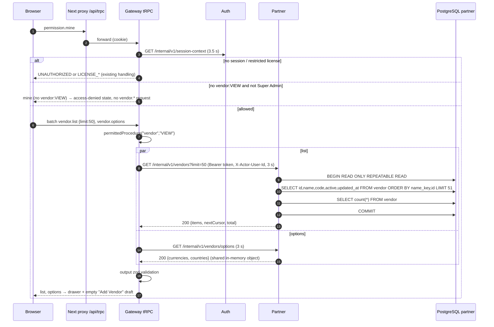
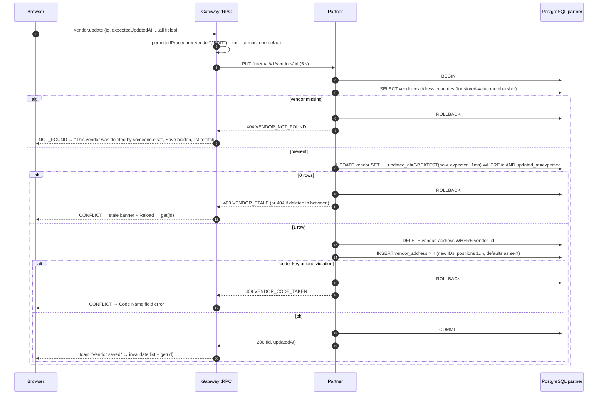
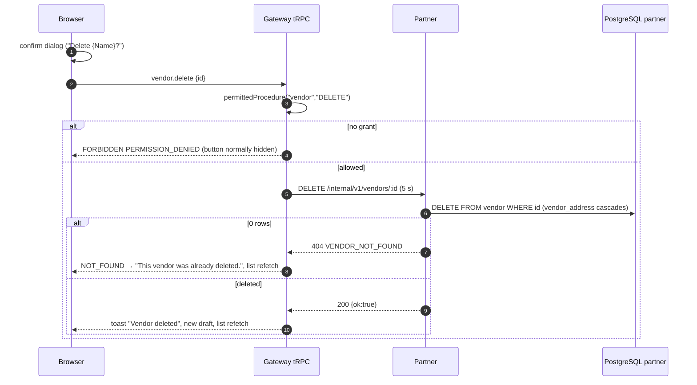

# Sequence diagram: partner + gateway / vendor

- Source UI revision / SA revision: 2 / 1 (**approved** 2026-10-15)
- Main user flow: [vendor-flow.md](../../../../diagram/vendor-flow.md)
- Related API operations / TODO IDs: [API contract](api-contract.md); BE-VEN-001…010; consuming FE-VEN-002, 008, 010, 011 ([central TODO](../../../../task/todo/vendor.md))
- Participants: Browser (Next.js `/setup/vendor`) → Next proxy `/api/trpc` → Gateway (NestJS + tRPC) → Auth (session-context only, unchanged) → Partner (NestJS) → PostgreSQL schema `partner`

Session, license and partner-unavailable branches are identical to the customer diagrams
([1](../customer/sequence-diagram.md#1-page-load-context-permission-list-and-options) and
[6](../customer/sequence-diagram.md#6-partner-unavailable-timeout-or-token-mismatch)); they are repeated here in
compact form so this file stands alone.

## 1. Page load: context, permission, list and options



## 2. Search, page and open a vendor

```mermaid
sequenceDiagram
    autonumber
    participant B as Browser
    participant G as Gateway tRPC
    participant S as Partner
    participant DB as PostgreSQL partner
    B->>G: vendor.list {q:"sample", cursor?}
    G->>S: GET /internal/v1/vendors?q=sample&cursor=… (3 s)
    alt cursor cannot be decoded
        S-->>G: 400 VALIDATION_ERROR {path:"cursor",code:"invalid"}
        G-->>B: BAD_REQUEST → client restarts without cursor
    else ok
        S->>DB: WHERE (name ILIKE '%sample%' OR code ILIKE '%sample%') AND (name_key,id) > cursor
        S-->>G: 200 page
        G-->>B: page
    end
    B->>G: vendor.get {id}
    G->>S: GET /internal/v1/vendors/:id (3 s)
    S->>DB: SELECT vendor + vendor_address ORDER BY position
    alt missing
        S-->>G: 404 VENDOR_NOT_FOUND
        G-->>B: NOT_FOUND → "This vendor no longer exists", list refetch, back to draft
    else found
        S-->>G: 200 VendorDetail (0 or 1 address with isDefault)
        G-->>B: VendorDetail (form filled; updatedAt kept as version)
    end
```

## 3. Create vendor (default optional)

```mermaid
sequenceDiagram
    autonumber
    participant B as Browser
    participant G as Gateway tRPC
    participant S as Partner
    participant DB as PostgreSQL partner
    B->>B: react-hook-form + Zod (approved rules)
    B->>G: vendor.create {…, invoiceAddresses[1..10]}
    G->>G: permittedProcedure("vendor","ADD") · zod strict · at most one default
    alt invalid shape or two defaults
        G-->>B: BAD_REQUEST VALIDATION_ERROR fieldErrors (invoiceAddresses.N.field / multiple_defaults)
    else no grant
        G-->>B: FORBIDDEN PERMISSION_DENIED
    else ok
        G->>S: POST /internal/v1/vendors (token, actor, 5 s, no retry)
        S->>S: zod + currency/country membership + default rule (zero stays zero)
        alt membership fails
            S-->>G: 400 VALIDATION_ERROR {currencyCode|invoiceAddresses.N.countryCode, unknown}
            G-->>B: BAD_REQUEST → field error, reload options
        else valid
            S->>DB: BEGIN (timeout 4 s)
            S->>DB: INSERT vendor (name_key, code_key, email lowered by PostgreSQL; created_by=actor)
            S->>DB: INSERT vendor_address × n (position 1..n, is_default as sent)
            alt unique violation on vendor_code_key_key
                S->>DB: ROLLBACK
                S-->>G: 409 VENDOR_CODE_TAKEN [{path:"code",code:"duplicate"}]
                G-->>B: CONFLICT → Code Name field error
            else committed
                S->>DB: COMMIT
                S-->>G: 201 {id, updatedAt}
                G-->>B: {id, updatedAt} → toast, invalidate list, open saved vendor
            end
        end
    end
```

## 4. Update vendor (whole replacement, optimistic concurrency)



## 5. Delete vendor (hard)



## 6. Partner unavailable, timeout or token mismatch

```mermaid
sequenceDiagram
    autonumber
    participant B as Browser
    participant G as Gateway tRPC
    participant S as Partner
    B->>G: any vendor.* call (permission already passed)
    G->>S: request (3 s read / 5 s write)
    alt connection refused / DNS / timeout / 503 / malformed or > 1 MiB response
        G-->>B: SERVICE_UNAVAILABLE PARTNER_UNAVAILABLE (no retry)
        Note over B: reads may be retried by the query client (≤ 2); mutations: list/record refetched before re-submit
    else 401/403 from partner (token wrong or missing)
        G->>G: log error "partner rejected service token" (no token value)
        G-->>B: SERVICE_UNAVAILABLE PARTNER_UNAVAILABLE (never UNAUTHORIZED)
    else other 5xx
        G-->>B: INTERNAL_SERVER_ERROR
    end
```
