# Database diagram: lot-based stock (SA revision 1, approved 2026-11-20)

Owners: `partner.*` = `backend-api-master`; `inventory.*` = `backend-api-inventory`. There is no FK across schemas: own-stock ids are plain uuids, as in ADR-0052 D20.

```mermaid
erDiagram
  MEMO_STOCK ||--o{ RESERVE_LINE_ALLOC : "allocated to"
  MEMO_STOCK ||--o{ MEMO_OUT_LINE_ALLOC : "allocated to"
  MEMO_STOCK ||--o{ MEMO_RETURN_LINE_ALLOC : "allocated to"
  MEMO_STOCK ||--o{ PURCHASE_LINE_ALLOC : "allocated to"
  MEMO_STOCK ||--o{ MEMO_OUT_RETURN_LINE_ALLOC : "returned from"
  MEMO_STOCK ||--o{ SALE_CONSUMPTION_LINE : "consumed"
  RESERVE_LINE ||--o{ RESERVE_LINE_ALLOC : "has"
  MEMO_OUT_LINE ||--o{ MEMO_OUT_LINE_ALLOC : "has"
  MEMO_RETURN_LINE ||--o{ MEMO_RETURN_LINE_ALLOC : "has"
  PURCHASE_LINE ||--o{ PURCHASE_LINE_ALLOC : "has"
  MEMO_OUT_RETURN_LINE ||--o{ MEMO_OUT_RETURN_LINE_ALLOC : "has"
  RESERVE_LINE ||--o{ SALE_CONSUMPTION_LINE : "settled by"
  SALE_LINE ||--o{ SALE_LINE_ALLOC : "copy of master result"

  MEMO_STOCK {
    uuid id PK
    varchar10 stock_id UK "unchanged"
    varchar40 lot "unchanged"
    varchar40 lot_key "NEW generated stored: ML+md5 or MS+id"
    int pending_pcs "buckets unchanged"
  }
  STOCK_INVENTORY {
    uuid id PK
    varchar10 stock_id UK
    varchar40 lot_key "NEW generated stored: OL+md5 or OS+id"
    int on_hand_pcs
  }
  RESERVE_LINE {
    uuid id PK
    uuid memo_stock_id "nullable (legacy)"
    uuid own_stock_id "nullable (legacy)"
    varchar40 lot_key "NEW nullable"
    smallint stock_count "NEW nullable"
  }
  RESERVE_LINE_ALLOC {
    uuid id PK
    uuid line_id FK "cascade"
    smallint seq "FIFO order"
    uuid memo_stock_id FK "nullable"
    uuid own_stock_id "nullable, no FK"
    varchar10 stock_id "snapshot"
    int pcs
    decimal weight_ct
    int settled_pcs "sold by Sale"
    decimal settled_weight_ct
  }
  MEMO_OUT_RETURN_LINE_ALLOC {
    uuid id PK
    uuid line_id FK
    uuid memo_out_line_alloc_id FK
    int pcs
    decimal weight_ct
  }
  PURCHASE_LINE_ALLOC {
    uuid id PK
    uuid line_id FK
    uuid memo_stock_id FK
    varchar10 part "SOLD or IN_STOCK"
    int pcs
    decimal weight_ct
  }
  SALE_CONSUMPTION_LINE {
    uuid sale_id PK
    uuid line_id PK
    uuid memo_stock_id PK "NEW in PK"
    uuid reserve_line_id "nullable"
    int pcs
    decimal weight_ct
  }
  SALE_LINE {
    uuid id PK
    uuid memo_stock_id "NOW nullable"
    varchar40 lot_key "NEW nullable"
  }
  SALE_LINE_ALLOC {
    uuid id PK
    uuid sale_line_id FK
    smallint seq
    uuid memo_stock_id "no FK cross-service"
    varchar10 stock_id
    int pcs
    decimal weight_ct
  }
```



`MEMO_OUT_LINE_ALLOC` and `MEMO_RETURN_LINE_ALLOC` have the `RESERVE_LINE_ALLOC` shape. Their `settled_*` means "returned by Memo Out Return" for Memo Out and is unused (0) for Memo Return. `PURCHASE_LINE_ALLOC` has no `settled_*`.

## Owner change 2026-11-21

- Master `20261121090000_lot_key_without_price`: `memo_stock.lot_key` = the expression below **without** `unit_price` and `net_unit_price`; both lot indexes rebuilt.
- Inventory `20261121090000_own_lot_key_per_stock`: `stock.lot_key` = `'OS' || id` for every stock (own stock not merged this round); `stock_lot_open_idx` rebuilt.
- **Migration order (INV-20261121-002 H3): master first, then inventory.** Master `20261121090000_lot_key_without_price` guards the master document lines (Quotation / Reserve / Memo Out may hold `OL...` own-lot keys that inventory's migration would orphan); inventory's migration only guards `sale_line`. Run inventory's migrate job only after master's migration succeeded (devops release contract).
- Both refuse to run while a document / Sale line names a lot.

### Release note (INV-20261121-002 H3 / H5)

1. Before applying either 2026-11-21 migration, **zero lot lines must exist**: no `lot_key` on Quotation / Reserve / Memo Out / Memo Return / Purchase lines (master) and no lot Sale line (inventory `sale_line.lot_key`). Check: `SELECT count(*) FROM partner.reserve_line WHERE lot_key IS NOT NULL` (repeat per table) and `SELECT count(*) FROM inventory.sale_line WHERE lot_key IS NOT NULL`. Both are 0 on dev and production at the time of writing; the migrations abort otherwise (re-key first).
2. Order: **master migration first** (its guard covers every master document line, including the `OL…` own-lot keys that inventory's migration would orphan), **then inventory**. Inventory's guard only covers `sale_line`.
3. Deploy: master, then inventory, then frontend. The migrations are backend-owned and run in the one-off migrate jobs (never at app start-up in production). The 2026-11-20 migrations stay unchanged (applied on dev).

## Generated keys (PostgreSQL 18, `postgres:18.6-alpine`; immutable expressions only)

```sql
ALTER TABLE partner.memo_stock ADD COLUMN lot_key varchar(40) GENERATED ALWAYS AS (
  CASE WHEN btrim(lot) = '' OR btrim(cer_no) <> '' THEN 'MS' || id::text
  ELSE 'ML' || md5(upper(btrim(lot)) || chr(31) || vendor_id::text || chr(31) || currency_code || chr(31) || stone || chr(31) || shape
    || chr(31) || size || chr(31) || color || chr(31) || clarity || chr(31) || cutting || chr(31) || quality || chr(31) || cer_type
    || chr(31) || location || chr(31) || price_unit || chr(31) || unit_price::text || chr(31) || net_unit_price::text || chr(31) || item_note) END) STORED;

ALTER TABLE inventory.stock ADD COLUMN lot_key varchar(40) GENERATED ALWAYS AS (
  CASE WHEN btrim(lot) = '' OR btrim(cer_no) <> '' THEN 'OS' || id::text
  ELSE 'OL' || md5(upper(btrim(lot)) || chr(31) || vendor_id::text || chr(31) || currency_code || chr(31) || stone_code || chr(31) || stone || chr(31) || shape || chr(31) || size || chr(31) || color
    || chr(31) || clarity || chr(31) || cutting || chr(31) || quality || chr(31) || cer_type || chr(31) || location || chr(31) || price_unit
    || chr(31) || unit_cost_base::text || chr(31) || stock_price::text || chr(31) || sale_price::text || chr(31) || item_note) END) STORED;
```

Key fields follow the owner's Q-LOT-04 answer: every item-level detail, including all price fields and the item note (the reading is in Q-LOT-04a/04b; if the owner narrows it, only these two expressions change). Document-level data (source doc no., dates) and the Stock ID are not in the key. Backend verifies that every function used is IMMUTABLE on the deployed PostgreSQL version. If `chr()` or a cast is not, it uses the literal `E'\x1f'`. `net_unit_price::text` is canonical for `numeric(18,4)`. Own-stock attribute edits (`applyStockEdit`) recompute the key automatically.

## Indexes and constraints

| Object | Definition | Purpose |
|---|---|---|
| `memo_stock_lot_open_idx` | `(lot_key, received_doc_date, stock_id) WHERE pending_pcs > 0 OR pending_weight_ct > 0` | lot pickers, candidate lock |
| `memo_stock_lot_sold_open_idx` | `(vendor_id, lot_key) WHERE sold_pcs > purchased_pcs OR sold_weight_ct > purchased_weight_ct` | Purchase Sold lots |
| `stock_lot_open_idx` (inventory) | `(lot_key, ref_doc_date, stock_id) WHERE status = 'ACTIVE' AND (on_hand_pcs > 0 OR on_hand_weight_ct > 0)` | own lots |
| `<doc>_line_lot_key` | `UNIQUE (document_id, source, lot_key) WHERE lot_key IS NOT NULL` on quotation/reserve/memo_out/memo_return lines; purchase `(purchase_id, lot_key, memo_group)`; sale `(sale_id, lot_key) WHERE source='STOCK'` | one group per document |
| stock reference CHECK | stock line ⇒ exactly one of `memo_stock_id`, `own_stock_id`, `lot_key` (source-consistent prefix: STOCK ⇒ `M%`, OWN_STOCK ⇒ `O%`) | replaces the current "exactly one id" CHECK |
| `<doc>_line_alloc` CHECKs | exactly one of memo/own stock id; `pcs ≥ 0`, `weight_ct ≥ 0`, not both 0; `0 ≤ settled ≤ qty`; `UNIQUE (line_id, memo_stock_id)`, `UNIQUE (line_id, own_stock_id)`; `INDEX (memo_stock_id)`, `INDEX (own_stock_id)` | integrity, `latestStockUser` lookups |
| `memo_return_line` | `memo_stock_id`, `stock_id` → NULL allowed | lot lines |
| `sale_line` (inventory) | `memo_stock_id` → NULL allowed; `sale_line_stock_key` widened to lot | lot lines |
| `sale_consumption_line` | PK `(sale_id, line_id, memo_stock_id)`; drop `sale_consumption_line_reserve_line_key` (unique per sale + reserve line), replace by `UNIQUE (sale_id, line_id, memo_stock_id)` (the PK) | many stocks per line |

`latestStockUser` (the "used by" lookup) adds one `UNION ALL` branch per alloc table on `memo_stock_id`. This stays one statement.

## Migration, backfill, rollback

**Master** `2026112xxxxxxx_lot_based_stock` (one transaction, maintenance window):

1. Add the generated column and the indexes.
2. Add the line columns and widen the CHECKs and nullability.
3. Create the 5 alloc tables.
4. Re-key `sale_consumption_line`.
5. Backfill (set-based, one statement per table), only for **applied** documents (status APPROVED, or auto-approved under ADR-0050, not deleted):
   - reserve, memo_out and memo_return lines with an item id → one alloc row (seq 1, qty = line qty, settled = `sold_*` for Reserve, `returned_*` for Memo Out, 0 for Memo Return);
   - purchase lines: IN_STOCK/SOLD → one row with part = memo_group; MERGED → two rows (SOLD = `sold_part_*`, IN_STOCK = qty − sold part, rows of 0 skipped);
   - memo_out_return lines → one row pointing at the memo_out_line alloc row;
   - own-stock lines likewise, with `own_stock_id`.
6. Verify (in the migration):
   - Σ alloc = line qty for every applied stock line;
   - Σ alloc per memo_stock across documents equals each bucket's documented sources (reserved = Reserve + Memo Out − returned; returned = Memo Return …). A mismatch aborts with a report query listed in the TODO.

**Inventory** `2026112xxxxxxx_lot_based_stock`:

- `stock.lot_key` and its index;
- `sale_line.lot_key` and `stock_count`, `memo_stock_id` nullable;
- the `sale_line_alloc` table;
- backfill one row per applied legacy STOCK/RESERVE sale line from the stored master result (`sale_sync_op` / line data: one memo stock per line).

**Rollback:**

- Before any lot line is applied: drop the new columns, tables and indexes, and restore the CHECKs (down scripts in the migration folder).
- After a lot line is applied: **forward-fix only**, because a lot line has no single item.
- The generated columns can be dropped at any time without data loss.

**Data size:** thousands of rows a year. Each backfill touches ≤ the existing line count, and the migration time is seconds.
