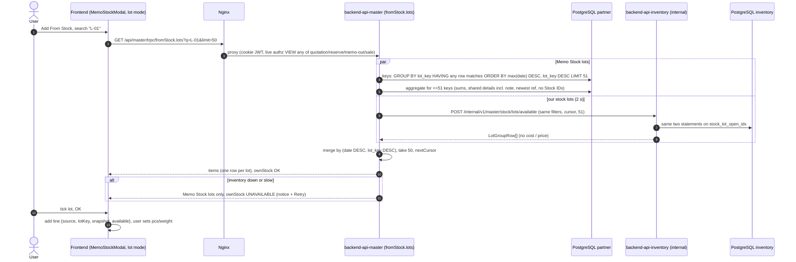
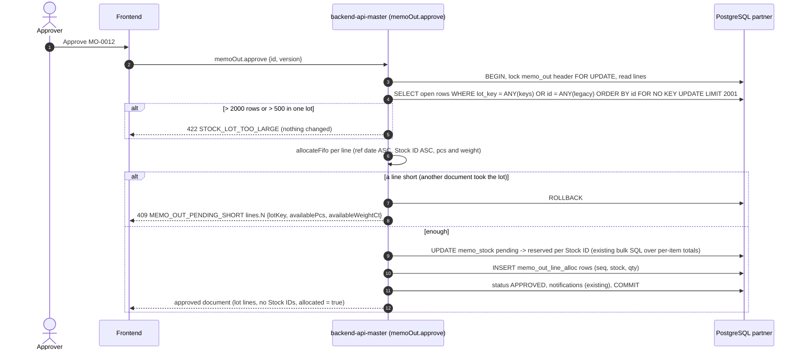
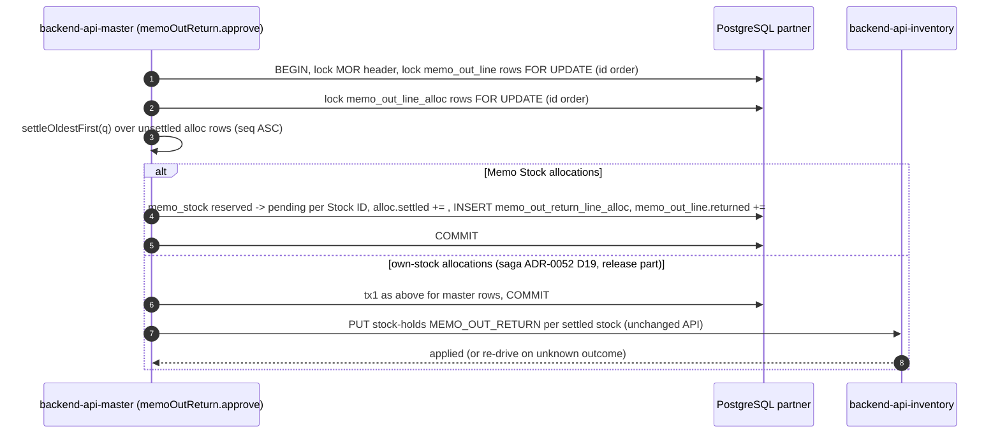
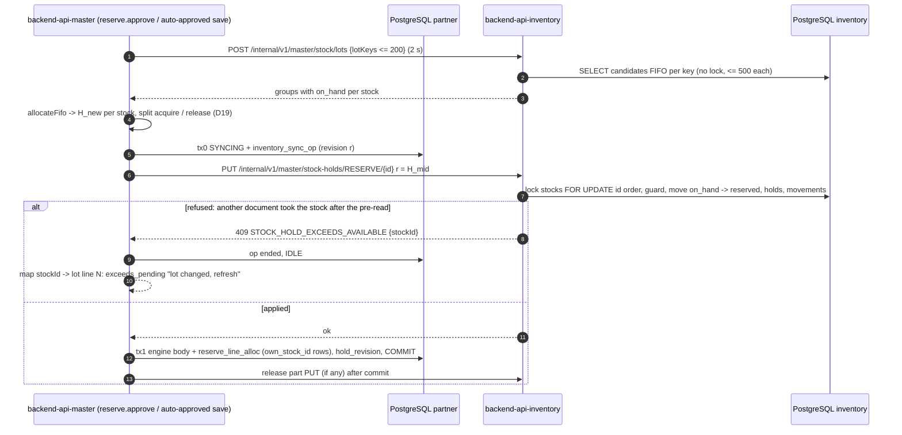
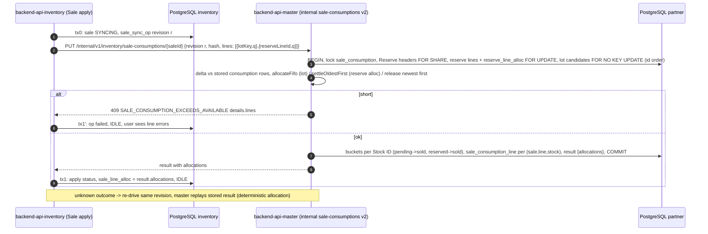
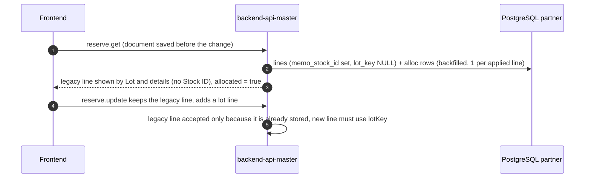

# Sequence diagrams: lot-based stock (SA revision 1, approved 2026-11-20)

No gateway: the browser reaches Nginx, which proxies `/api/master/*` to `api-master:3201` (workspace `backend-api-master`) and `/api/inventory/*` to `backend-api-inventory:3301`. Internal calls go service to service on the `inventory-master` network.

## 1. Pick a lot (From Stock: Quotation / Reserve / Memo Out / Sale)

## 2. Approve a Memo Out with Memo Stock lot lines (allocation FIFO)

Concurrent approvals of the same lot both lock the same rows in id order. The second waits, re-reads the pending quantity and either allocates the remainder or is short. The same holds for Reserve (pending → reserved), Memo Return (pending → returned) and Purchase (sold part first, then pending → sold + purchased).

## 3. Memo Out Return of part of a lot line (settle oldest first)

## 4. Reserve with own-stock lot lines (pre-read → allocate → unchanged hold PUT)

## 5. Sale (inventory) From Stock lot line and From Reserve line

## 6. Legacy document (no conversion)

