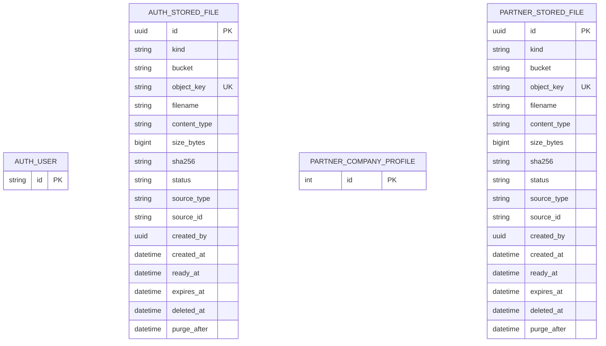

# Database design: service-owned file metadata

- Source / SA revision: existing user-permission and company-profile behavior / 3
- Owning schemas: `auth` and `partner` (partner may later become master only through approved cutover)
- Actual schemas: `backend-api-auth/prisma/schema.prisma`, `backend-api-partner/prisma/schema.prisma`
- Status: implementation in progress; expand migrations authored

Each service creates its own `stored_files` table based on GMS Appendix B. `auth` associates one ready row with a user photo; `partner` associates one ready row with company profile id `1`. Keep no cross-schema FK. Service metadata is the source for content type, size, SHA-256 and object key; existing photo/logo response contracts are derived from it.

The entity columns are logical references only (`source_type` + `source_id`); there is deliberately no FK, so entity deletion cannot cascade away retention metadata. Keep unlimited historical rows and enforce only one ready row per entity with a partial unique index. For all user-uploaded files in `files` and `public`, set `deleted_at` when replaced/removed, leave `purge_after` null, and retain bytes and metadata forever. System-generated documents/exports use their existing retention policies.

Required constraints: use the Appendix B column set, with unrelated export fields nullable; bucket/kind/status allowlists; unique `(bucket, object_key)`; SHA-256 64 hex; `size_bytes > 0`; indexes on `(source_type,source_id)`, partial unique `(source_type, source_id) WHERE status='ready'`, and `(created_by,created_at DESC)`. Use UUIDv7 generated in application with PG16-compatible defaults per platform spec.

Migration/backfill: create metadata tables and compatibility reads first; copy each existing object, calculate/verify checksum, insert ready row, compare entity count/hash and API output; switch reads; pause writes for final delta; switch writes; only then remove legacy photo/logo metadata columns in a later contract migration. Rollback keeps old metadata and volumes until owner-approved window closes. No file bytes enter PostgreSQL.
