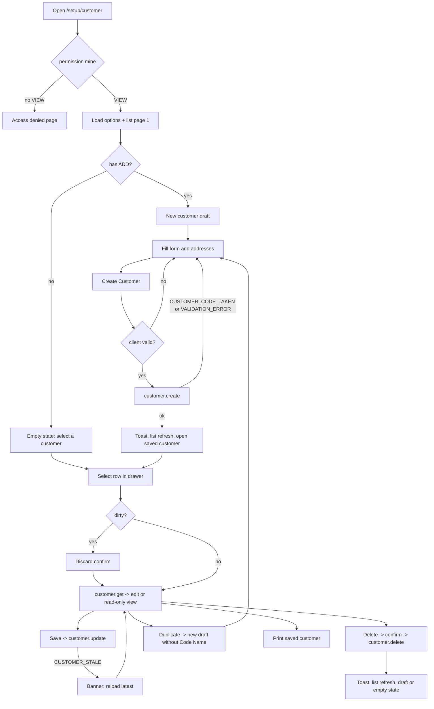

# UI specification: customer

- Feature ID / revision: `customer` / 3 (revision 3 = [draft row title and address card design](#revision-3-draft-row-and-address-card) on top of revision 2; revision 2 = [ADR-0021 changes](#revision-2-adr-0021) on top of revision 1 below)
- Status: revision 1 approved 2026-10-14; revision 2 approved 2026-10-16 with ADR-0021 ("...ทำ adr เเล้วเริ่มทำเลย"); revision 3 approved 2026-10-16 by the owner instruction quoted in [revision 3](#revision-3-draft-row-and-address-card)
- Source: three owner-supplied screenshots (not Figma), in [source/](source/)
- Viewport / source dimensions: all three are 1920×1080 px. **Assumption:** device-pixel ratio 1, so the viewport is 1920×1080 CSS px. This is supported by the shell geometry, which matches the user-permission source at DPR 2 exactly (sidebar ~235, header ~47, drawer ~319 CSS px). All CSS values below are estimates unless marked as sampled.
- Inspection evidence: each image viewed with the image reader. Pixel colors and edges sampled on the originals with System.Drawing on 2026-10-14. No Figma file or design tokens were supplied.
- Governing decision: [ADR-0018](../../../adr/0018-customer-master-partner-service.md) revision 1, **Accepted** 2026-10-14 ("อนุมัติ ADR-0018"). Where the design and the ADR differ, the ADR wins (see [deviations](#deviations-from-the-design-adr-0018-and-owner-decisions)).
- Requirements / main flow: [main flow](#main-user-flow) below. The editable flow [customer-flow.md](../../../diagram/customer-flow.md) is owned by SA (ADR-0018 follow-up step 2; SA draft revision 1, pending-review). [Open questions](open-questions.md)
- Review bundle: this file, [design-system.md](design-system.md), [conventions.md](conventions.md), [form-guidelines.md](form-guidelines.md), [data-fetching.md](data-fetching.md), [error-handling.md](error-handling.md), [dependencies.md](dependencies.md), [testing.md](testing.md), [open-questions.md](open-questions.md); central TODO: [`document/task/todo/customer.md`](../../../task/todo/customer.md)
- Pattern feature: [user-permission](../user-permission/ui-spec.md) (UI revision 1, approved 2026-10-12; implemented in `frontend/src/features/user-permission/`)

## Revision 3 (draft row and address card)

- Owner instruction (2026-10-16), recorded as approval of customer UI revision 3 and vendor UI revision 4: "frontend backend ปรับให้หน่อยตอนเขียนcode name ตรง draft ไม่ต้องเปลี่ยนตามนะ เป็น new customer นั้นเเหละ และนี่คือ รูปที่สองและสามเป็นแบบใหม่ของ invoice address ในทั้ง customer และ vendor set as default address ย้ายมาด้านบนแทน เลข 1 ด้วย เปลี่ยนตามที่บอกให้หน่อย"
- Source: [rev3-01-current-draft-row-issue.png](source/rev3-01-current-draft-row-issue.png) (the bug: the draft row title followed the typed Code Name), [rev3-02-address-card-no-default.png](source/rev3-02-address-card-no-default.png) (new card, unchecked) and [rev3-03-address-card-default-checked.png](source/rev3-03-address-card-default-checked.png) (new card, #1 checked). Viewed with the image reader on 2026-10-16. Vendor revision 4 uses the matching vendor images.
- Frontend-only. No API, schema, contract or business-rule change; the default-address rules stay those of ADR-0018 (customer) and ADR-0019 (vendor) and match the backend.
- Implemented in the shared module (`frontend/src/features/partner/components/address-item.tsx`, `address-list-card.tsx`, `partner-drawer.tsx`), so Vendor gets the same design. TODO IDs: FE-CUS-R3-001 … FE-CUS-R3-004.

| Area | Revision 3 behavior | Supersedes |
|---|---|---|
| Drawer draft row | Fixed title **"New customer"**, subtitle **"Not saved yet"**, "Draft" badge. The title never mirrors the Code Name or Name being typed (owner: "ตรง draft ไม่ต้องเปลี่ยนตามนะ เป็น new customer"). Saved rows are unchanged (bold Code Name / Name) | revision 2 "Drawer rows" draft-row text; DV-02 |
| Address item layout | "#N" label on the **left, outside** the card (bold 15 px, not focusable; the `<fieldset>` legend "Invoice address #N" stays the accessible name). Card: light gray `gms-page` fill, radius `gms-lg` (12 px), no visible border (red border while any field has an error, DV-12), padding ~16 px. **No collapse chevron and no "Default" badge**; every item is always open | Address item (accordion) row, C-11 expanded/collapsed, "Collapse/expand item" interaction, "Has errors" collapsed tag |
| First row in the card | "Set as default address" checkbox on the left; red trash icon on the right | checkbox as the last row; trash in the accordion header |
| Field grid | Unchanged: Name/Company Name\* + Tax ID; Address\* full row; Country\* + State/Province\*; City\* + Postcode\* (Shipping: Name\* full row, then the same rows) | - |
| Add button | Dashed "+ Add another invoice address" below the items; Shipping keeps "+ Add another shipping address". Count badge next to the section title unchanged | - |
| Shipping | Uses the same card for consistency (the mock shows Invoice only) | - |
| Trash | Rules unchanged: item #1 cannot be removed, so its trash icon renders **disabled** (tooltip "The first invoice address cannot be removed"); items #2+ are removable; 1-10 items. After removing an item, focus moves to the previous item's default checkbox | trash hidden on #1; focus to the previous header button |
| Read-only (view mode / no EDIT) | Checkbox and trash are shown disabled (`aria-disabled` checkbox, `disabled` trash) | trash hidden in read-only |
| Default rule (unchanged, ADR-0018 §3 / P-01) | Exactly one default per address type. Checking another item moves the default there. The checked default cannot be unchecked: it stays checked with `aria-disabled` and the hint "One address must be the default". A new customer starts with **#1 checked** for Invoice and Shipping. Removing the default item makes #1 the default | - |

Design items **not** followed in revision 3: the mock shows #1 **unchecked** (rev3-02); for Customer that state is not allowed (exactly one default, ADR-0018), so a new customer shows #1 checked as in rev3-03. The mock shows an enabled trash icon on #1; #1 stays non-removable, so it is shown disabled. Submit with errors no longer needs to expand items (all are open); it still focuses the first error in visual order.

## Revision 2 (ADR-0021)

- Source: [rev2-01-add-customer-view-edit-header.png](source/rev2-01-add-customer-view-edit-header.png) (full page, 3840×2160, DPR 2 → 1920×1080 CSS) and [rev2-02-drawer-row-code-name.png](source/rev2-02-drawer-row-code-name.png) (one drawer row). Both viewed with the image reader on 2026-10-16. Vendor revision 3 uses the same images.
- Governing decision: [ADR-0021](../../../adr/0021-partner-code-running-number-and-record-modes.md) (Accepted 2026-10-16). Header/mode model: User & Permission revision 2 ([ADR-0020](../../../adr/0020-username-login-and-permission-matrix-v2.md)).
- Implemented in the shared Partner Master module (`frontend/src/features/partner/**`), so the same behavior applies to Vendor.

| Area | Revision 2 behavior | Supersedes |
|---|---|---|
| Title | Create mode "Add Customer"; view/edit mode = the saved customer's Name (while it loads: "Customer"); next to it "Customer List N" (capital L) | ui-spec "Page header row" title per mode; Q-CUS-03 "Edit Customer" |
| Header icons | Print (saved customer loaded), Excel (`aria-disabled`, tooltip "Excel export isn't available yet"), Duplicate (ADD, saved loaded), Refresh — unchanged behavior | — |
| Header buttons | Second row, right-aligned: **Create Customer** (+ icon), **Cancel**, **Save** (primary), **Edit** (primary, pencil), **Delete** (danger). Create mode: Cancel + Save enabled, the rest disabled. View mode: form read-only; Create/Edit/Delete enabled; Cancel/Save disabled. Edit mode: Cancel + Save enabled. Saving/deleting disables the others. Create/Edit/Delete are hidden without ADD/EDIT/DELETE; Cancel/Save hidden for users with neither ADD nor EDIT (P-05 / ADR-0016 kept) | toolbar table (single Create Customer / Save button, Delete next to Refresh); Q-CUS-02 placement |
| Modes | Selecting a customer opens **view** (read-only for everyone). **Edit** makes it editable (focus Code Name). **Cancel** in edit restores the saved values and returns to view; in create it returns to the customer that was open before Create Customer / Duplicate, otherwise starts a fresh draft. **Save** in edit updates and returns to view; in create opens the new customer in view. Delete keeps the existing confirm dialog. Unsaved-change prompt kept for row switch, Refresh, Duplicate, Create Customer and the draft row | always-editable form for users with EDIT |
| Code Name | Required `*`: trimmed, 1–120 characters; empty → "Code Name is required"; > 120 → "Code Name must be at most 120 characters"; first in focus order | Code Name optional (revision 1, form-guidelines) |
| Suggested code | In create mode (with ADD) the field is prefilled from `customer.nextCode` (`{code:"C001"}`); editable. The suggestion is the field default, so an untouched draft is not "unsaved". It is requested again whenever create mode starts (incl. Duplicate, Cancel, Refresh, after delete). A value the user typed is never replaced | Duplicate "clears Code Name" (TC-CUS-22) now clears and prefills the suggestion |
| Code taken | `CUSTOMER_CODE_TAKEN` → field error "This code name is already in use" and `nextCode` is refetched. If the field still held the untouched suggestion, it is replaced by the new one and the error reads "C001 is already in use. C002 is suggested instead; check it, then save again." | — |
| Drawer rows | Bold first line = **Code Name**; second line = **Name**; green dot = Active, "Inactive" badge otherwise; draft row: typed Code Name (fallback "New customer") / typed Name (fallback "Not saved yet"); search by name or code unchanged. A legacy row without a code shows "No code name" in placeholder color on the first line | DV-02, P-08, TC-CUS-16/17 |

Design items **not** followed in revision 2 (ADR-0021 §3, §5): "Create User" → "Create Customer"; drawer title "Vendors" → "Customers"; sidebar "Vender" → existing "Vendor"; drawer search placeholder "Search name or username..." → "Search name or code name..."; draft row "New user / superadmin@example.com" → code/name; sample data `SAMPLE-VENDOR-A` / `V-0001 · Sample Vendor A Co., Ltd.` is illustration only (owner: first line Code Name, second line Name).

## Source and evidence

| # | File | SHA-256 (prefix) | State shown |
|---|---|---|---|
| 1 | [01-validation-errors-drawer-open.png](source/01-validation-errors-drawer-open.png) | `3d948c2fe49b3aec` | Add mode, drawer open. Required errors on Name, Currency, First name, Email; a format error on Phone No.; Invoice item #1 frame in the error color. One Invoice and one Shipping address, both expanded and Default. |
| 2 | [02-second-invoice-address-drawer-collapsed.png](source/02-second-invoice-address-drawer-collapsed.png) | `3089d08cb3646f5a` | Drawer collapsed, form widened. Invoice has 2 items: #1 collapsed (Default badge), #2 expanded (trash icon, default unchecked). Shipping has 1 item. |
| 3 | [03-second-invoice-address-drawer-open.png](source/03-second-invoice-address-drawer-open.png) | `b8dd97c95f110286` | Same form as 2 with the drawer open. |

## Source quality

| Kind | What it covers |
|---|---|
| **Sampled from pixels** (exact in the PNG, approximate for the design) | Colors in [design-system.md](design-system.md); 1 px borders; drawer ~319 px; field height 52 px; drawer toggle 24×40 |
| **Estimated from the image** | Font family and sizes, radii, spacing, grid widths, row pitches |
| **ADR-0018 / owner decisions** | Route, Setup tab, sidebar link, drawer title and row content, Delete button, header button behavior, field rules, permissions, Currency/Country lists, State/City as text |
| **Existing code facts** | `AppShell`, `SetupTabs`, user-permission primitives and drawer, `globals.css` `gms-*` tokens, `permission.mine` output (`{ isSuperAdmin, permissions: "ALL" \| string[] }`), permission catalog menu key `customer` |
| **Assumptions / proposals** (listed in [open questions](open-questions.md)) | DPR 1; Delete button placement; edit-mode title and button label; default-address checkbox semantics; print layout; responsive behavior; error copy |
| **Not in source** | Edit mode for a saved customer, Delete trigger and dialog, success feedback, server errors, loading/empty states, list pagination, a dirty-form confirmation, print output, mobile/tablet layout |

## Deviations from the design (ADR-0018 and owner decisions)

| ID | Design shows | Implement instead | Authority |
|---|---|---|---|
| DV-01 | Drawer title "Vendors" | "Customers" | ADR-0018 §5 (owner confirmed the design is wrong) |
| DV-02 | Draft row "New user / superadmin@example.com" | Bold line = the Name being typed (fallback "New customer"); second line = the Code Name being typed (fallback "Not saved yet"); "Draft" badge | ADR-0018 §5 |
| DV-03 | Search placeholder "Search name or username..." | "Search name or code name..." | ADR-0018 §2 (`customer.list` searches Name/Code Name) |
| DV-04 | State/Province and City are dropdowns ("Choose a country first") | **Text inputs**, disabled with placeholder "Choose a country first" until a Country is chosen | ADR-0018 §4 |
| DV-05 | Country looks like an empty plain input (no chevron) | Dropdown of ISO 3166-1 countries from `customer.options` | ADR-0018 §4 |
| DV-06 | Shipping card button reads "Add another invoice address" | "Add another shipping address" | Design copy error; proposal (owner instruction for this spec) |
| DV-07 | No Delete button | Delete button (danger) for a saved customer when the user has `customer:DELETE`, with a confirm dialog like Delete user | ADR-0018 §5, owner request |
| DV-08 | Breadcrumb "Breadcrumbs Item › Breadcrumbs Item › Customer"; no Setup tab bar | Breadcrumb `Home › Setup › Customer`; the existing `SetupTabs` bar with a new active "Customer" tab | ADR-0018 §5; user-permission pattern |
| DV-09 | Excel icon looks enabled | Excel is `aria-disabled` with tooltip "Excel export isn't available yet" | ADR-0018 §5 |
| DV-10 | Sidebar differs from the current `AppShell` (same gap as user-permission Q-UP-21) | Keep the current `AppShell`. Only the Partner Master › Customer link changes, to `/setup/customer`. | ADR-0018 §5; user-permission precedent |
| DV-11 | Light grey band `#F3F3F5` behind the title row in all three images | Not implemented (same decision as user-permission Q-UP-26) | Pattern consistency; flagged in design-system.md |
| DV-12 | Invoice item #1 frame is red, but its fields are not | Item frame turns red when **any** field inside it has an error, **and** each field shows its own error | Proposal: the frame is the only signal for a collapsed item |

## Page structure and layout

All positions are CSS px estimates at 1920×1080.

| Region | Observed layout | Evidence |
|---|---|---|
| Sidebar, top header | Existing `AppShell` (not restyled; DV-10). Breadcrumb `Home › Setup › Customer`. | S1 |
| Setup tab bar | Existing `SetupTabs` (`frontend/src/features/setup/setup-tabs.tsx`) with a new tab **Customer** (proposal: right after "User and permission", Q-CUS-04). Active state uses the existing underline. | ADR-0018 §5 |
| Content area | Background `#F9F9F9`. Padding 24 px top/left, about 40 px right when the drawer is open (room for the toggle tab, as in user-permission). Scrolls vertically. | S1 |
| Page header row | Height ~36 px at y≈72. Left: `<h1>` "Add Customer" (~24 px) + secondary "Customer list {total}" (~14 px). Right: icon buttons Print, Excel (green icon), a ~12 px gap, Duplicate, Refresh (36×36 each), then the primary button "Create Customer" (~170×36, plus icon). The new Delete button sits between Refresh and the primary button (proposal, Q-CUS-02). | S1–S3 |
| Customer Information card | White, 1 px border, radius ~12. Header ~65 px: "Customer Information" (~18 px, medium) and, on the right, the Active switch + "Active" label. 1 px divider. Body padding ~24 px top, ~39 px left/right. | S1 |
| Customer Information fields | 3-column grid, gap ~17 px horizontal, ~20 px vertical (row pitch 72 px without errors). The grid is **capped at ~1290 px wide and left-aligned**: with the drawer collapsed each column stays ~420 px and the card has empty space on the right (S2). Row 1: Code Name, Name\*, Currency\*. Subheading "Basic Information" (~14 px, medium) with ~16 px above. Row 2: First name\*, Middle name, Last name. Row 3: Phone No., Email\*, (empty). An error message adds ~24 px under its row (S1). | S1, S2 |
| Gap between cards | ~16–18 px vertical; ~24 px between the two address cards | S1–S3 |
| Address cards | Two cards side by side, equal width: **Invoice Address** (left) and **Shipping Address** (right). Each card: header ~55 px with title (~18 px, medium) + count badge (the number of items); 1 px divider; body padding 16 px; items stacked with ~16 px gap; then a full-width dashed "Add another … address" button (~42 px tall). | S1–S3 |
| Address item (accordion) | 1 px `#EDEDED` border, radius ~8, background `#F9F9F9`. Header row ~46 px: chevron button + "#n" (bold) on the left; on the right a "Default" badge (default item) and/or a trash icon (items #2 and later). 1 px divider when expanded. Body padding ~16 px; fields in a 2-column grid (gap 16) with white inputs; row pitch 68 px. Invoice rows: Name/Company Name\* + Tax ID; Address\* (full width); Country\* + State/Province\*; City\* + Postcode\*. Shipping rows: Name\* (full width); Address\* (full width); Country\* + State/Province\*; City\* + Postcode\*. Last row: "Set as default address" checkbox (20 px, primary). | S1–S3 |
| Customers drawer (open) | Right side under the tab bar, ~319 px wide, full height, white, 1 px left border `#E8E8E8`. **Pushes** content (S2 vs S3). Header ~58 px: "Customers" (DV-01) + count badge (total) + close X. Search field (~40 px) with a leading search icon. List: draft row, then saved rows (row pitch ~78 px). | S1, S3 |
| Drawer toggle | 24×40 tab, `#0E6064`, white chevron, on the drawer's outer left edge (open) or the right edge of the content (collapsed). | S1–S3 |
| Drawer rows | Draft: plus icon, two lines, "Draft" badge, selected style (1 px primary border, `#FAFCFC` background). Saved: 8 px green status dot, **Name** (bold, ~14–15 px), **Code Name** on the second line (secondary, ~14 px), "Inactive" badge on the right for inactive customers. | S1 |

### Scrolling and sticky behavior (proposal)

- Sidebar, header, tab bar and drawer stay fixed; only the content area scrolls (same as user-permission).
- The page header row is not sticky (not shown in the source).
- The drawer list scrolls on its own and loads the next page at the end of the list (see [data-fetching.md](data-fetching.md)).

### Responsive behavior (proposal, not in source; Q-CUS-05)

Same rules as the user-permission proposal (its Q-UP-23), plus the address cards:

| Width | Behavior |
|---|---|
| ≥1280 px | As in the source; the drawer pushes content. Address cards side by side when the content area is at least ~1000 px wide (a container query), otherwise stacked. |
| 1024–1279 px | The drawer overlays the content (non-modal, dismissible). Customer Information uses 2 columns. Address cards stack. |
| 768–1023 px | Existing `AppShell` behavior (sidebar hidden below `md`). 2 columns; address item fields stay 2 columns. |
| <768 px | 1 column everywhere. Toolbar icon buttons collapse into a "More" menu; the primary button stays visible. The drawer becomes a full-width sheet. |

## Component inventory

"Shared" means the primitive is promoted from `frontend/src/features/user-permission/components/ui/` to a shared folder by FE-CUS-001 (see [conventions.md](conventions.md#shared-primitives-reuse-and-promotion)). Nothing is copied.

| ID | Region / component | Existing implementation | Props / states | Source evidence |
|---|---|---|---|---|
| C-01 | AppShell | `frontend/src/features/home/app-shell.tsx` (reuse; sidebar link change only, FE-CUS-003) | breadcrumb `Home › Setup › Customer` | S1 |
| C-02 | SetupTabs | `frontend/src/features/setup/setup-tabs.tsx` (add one tab) | new tab Customer → `/setup/customer`, `aria-current="page"` | ADR §5 |
| C-03 | PageHeader + toolbar | Pattern: `user-permission/components/page-header.tsx`; new `customer/components/customer-page-header.tsx` | title per mode (Add Customer / Edit Customer, Q-CUS-03), subtitle "Customer list {total}", buttons per [toolbar table](#header-toolbar) | S1–S3 |
| C-04 | IconButton, Button | Shared (`ui/button.tsx`) | `primary` / `secondary` / `danger`; `loading`; IconButton needs an **`aria-disabled` + tooltip** mode for Excel (new prop, FE-CUS-001) | S1 |
| C-05 | Card, CountBadge | Shared (`ui/card.tsx`) | Card `trailing` slot holds the Active switch | S1 |
| C-06 | Switch ("Active") | Shared (`ui/switch.tsx`) | on/off, read-only (no EDIT permission) | S1 |
| C-07 | TextField (notched outlined field) | Shared (`ui/outlined-field.tsx`: `FieldShell`, `TextField`) | required `*`, error (fill `#FAE6E4`, border/label `#DF1016`, italic message), **disabled** state (fill `#F8F8F8`, placeholder `#A9A9A9`; new, FE-CUS-001), read-only | S1 |
| C-08 | SelectField (Currency, Country) | **New shared** `ui/select-field.tsx` on `FieldShell` + native `<select>` | placeholder option ("Select currency" / "Select country"), chevron icon, loading ("Loading…" disabled option), error, disabled, read-only | S1 (Currency) |
| C-09 | PhoneField | Shared (`ui/phone-field.tsx` + `phone.ts`) | optional; country selector + national number; error | S1 |
| C-10 | AddressListCard | New `customer/components/address-list-card.tsx` | `type` INVOICE / SHIPPING, items (`useFieldArray`), count badge, add button disabled at 10, helper text at the limit | S1–S3 |
| C-11 | AddressItem (accordion) | New `customer/components/address-item.tsx` | expanded/collapsed, `#n`, Default badge, trash (n ≥ 2), error frame (DV-12), fields per type, default checkbox | S1–S3 |
| C-12 | Checkbox ("Set as default address") | Shared `ui/checkbox.tsx` (promoted; today it has only the matrix `TriStateCheckbox` with an `aria-label`). Add a `LabeledCheckbox` export with a visible `<label>`, 20 px box (FE-CUS-001). | checked (primary fill, white check), unchecked (1 px **primary** border, white — sampled S2, unlike the grey matrix box), checked-and-locked (`aria-disabled`, hint), focus | S1, S2 |
| C-13 | DashedAddButton | New in `address-list-card.tsx` | default, hover, focus, disabled (at 10); label "Add another invoice address" / "Add another shipping address" | S1–S3, DV-06 |
| C-14 | Badge | `CountBadge` (shared) + new variants `default` (green), `draft` (amber), `inactive` (grey) | text badges; color is never the only signal | S1, S2 |
| C-15 | CustomersDrawer | New `customer/components/customers-drawer.tsx`, built from shared primitives on the `users-drawer.tsx` pattern | open/collapsed, header, search, draft row, saved rows, load-more, loading/empty/error | S1, S3 |
| C-16 | Drawer toggle | Pattern in `user-permission-page.tsx` (toggle button) | `aria-expanded`, `aria-controls`; focus returns to it when the drawer closes | S1–S3 |
| C-17 | ConfirmDialog | Shared (`ui/confirm-dialog.tsx`) | Delete customer; Discard unsaved changes | Pattern (user-permission S4) |
| C-18 | Toast | Shared (`ui/toast.tsx`) | success/info/error, top-center | Pattern (user-permission S5) |
| C-19 | FormError banner | Pattern in `user-permission-page.tsx` (`role="alert"` paragraph) | server errors that do not map to a field; stale-update banner with a "Reload" action | not in source |
| C-20 | CustomerPrintView | New `customer/components/customer-print-view.tsx` | print-only layout of the saved customer (`hidden print:block`) | ADR §5 |
| C-21 | AccessGuard | Pattern in `user-permission-page.tsx` | pending skeleton, error + Retry, denied page | not in source |

### Header toolbar

| Button | Icon (lucide) | Shown when | Enabled when | Action | Permission (UX only) |
|---|---|---|---|---|---|
| Print | `Printer` | always | a saved customer is open and loaded | `window.print()`; prints C-20 (the **saved** data, not unsaved edits; tooltip "Print saved customer") | `customer:VIEW` |
| Excel | `FileSpreadsheet` (green) | always | never | `aria-disabled="true"`, tooltip "Excel export isn't available yet", focusable | — (ADR: not built) |
| Duplicate | `CopyPlus` | user has ADD | a saved customer is open and loaded | Copies the **saved** customer into a new draft, clears Code Name and all address IDs; confirm first if the form is dirty; focus Name; info toast "Copied from {Name}. Enter a code name if needed, then create the customer." | `customer:ADD` |
| Refresh | `RotateCw` (spins while fetching) | always | always | Confirm if dirty; then refetch the list and the open customer and reset the form to the fresh data | `customer:VIEW` |
| Delete | `Trash2`, label "Delete" | a saved customer is open and the user has DELETE | not while saving/deleting | Opens the delete ConfirmDialog | `customer:DELETE` |
| Create Customer | `Plus` | draft mode and the user has ADD | not while submitting (`Creating...`) | Submits the form | `customer:ADD` |
| Save | `Save` (proposal) | edit mode and the user has EDIT | not while submitting (`Saving...`) | Submits the form | `customer:EDIT` |

Buttons the user is not permitted to use are **hidden** (proposal; the ADR allows hide or disable). Excel is the only disabled button.

### Customers drawer list

| Row part | Content | Format |
|---|---|---|
| Status | 8 px dot: green `#1C744A` when active, `#ADB1B4` when inactive; plus screen-reader text ", active"/", inactive" | — |
| Line 1 | `name` | bold, 1 line, ellipsis |
| Line 2 | `code` (Code Name); when empty, "No code name" in placeholder color | secondary, 1 line, ellipsis |
| Trailing | "Inactive" badge when `active = false` | grey badge |

- Order: as returned by `customer.list` (SA decides; the ADR index `(active, name)` suggests active first, then by name).
- Search: server-side through `customer.list` (Name or Code Name), debounced 300 ms, trimmed; an empty query shows all. Empty result: `No customers match "{q}"`.
- Paging: 50 rows per page; the next page loads when the last row scrolls into view, with a "Load more" button fallback for keyboard users.
- Selection: clicking a row opens that customer (edit mode, or read-only without EDIT). `aria-current="true"` on the selected row. Confirm first if the form is dirty.
- Draft row: shown first only for users with ADD. Selected while a new customer is being entered.
- The header count badge and "Customer list {total}" show the unfiltered `total`.

## Interaction and data

| Interaction | Trigger | Result | Status |
|---|---|---|---|
| Open page | Sidebar Partner Master › Customer, or Setup tab Customer | `/setup/customer`. Access check first (`permission.mine`). Users with ADD start on a new draft; users without ADD see "Select a customer from the list" until they pick one. Drawer open. | ADR §5 |
| Toggle drawer | Edge tab or X | Collapse/expand; content reflows (S2/S3); focus on the toggle; open state may be remembered in `localStorage` (try/catch, convenience only) | S1–S3 |
| Search | Drawer search | Server search as above | ADR §2 |
| Open customer | Click a saved row | Loads `customer.get`; the form resets to it; title "Edit Customer"; primary button "Save" | Q-CUS-03 |
| New customer | Click the draft row | Empty form (Active on, 1 Invoice + 1 Shipping item, both default); focus Name | ADR §3 |
| Create | Create Customer | Validate all ([form-guidelines.md](form-guidelines.md)); on error expand items with errors and focus the first; if valid → `Creating...` → `customer.create` → toast "Customer created", list refreshed, the new customer opened | ADR §5 |
| Save | Save | Same validation → `customer.update` with the loaded `updatedAt` → toast "Customer saved", `get` refetched and the form reset to it (the update returns only `{ id, updatedAt }`) | ADR §2 |
| Duplicate | Duplicate | See toolbar table | ADR §5 |
| Delete | Delete | ConfirmDialog "Delete {Name}?" / body "The customer and all of its addresses will be permanently deleted. Documents that already use this customer keep their own copy of its name. This can't be undone." / "Keep customer" / "Delete" → "Deleting..." → toast "Customer deleted", list refreshed, back to the draft (or the empty state without ADD) | ADR §5, DV-07 |
| Print | Print | See toolbar table | ADR §5 |
| Refresh | Refresh | See toolbar table | ADR §5 |
| Add address | Dashed button | Appends an expanded item (#n), focuses its first field; disabled at 10 with helper "Up to 10 {invoice/shipping} addresses" | ADR §3 |
| Remove address | Trash icon (items #2+) | Removes the item immediately (nothing is saved until Create/Save), renumbers, moves focus to the previous item's header; if it was the default, item #1 becomes the default. Accessible name "Remove invoice address #2". | ADR §3 |
| Collapse/expand item | Chevron button | Local UI state; `aria-expanded`; values kept | S2 |
| Set default | "Set as default address" | Checking moves the default to this item (the others uncheck). The checked default cannot be unchecked (`aria-disabled`, hint "One address must be the default"). The Default badge follows. | ADR §3; proposal for the checkbox semantics |
| Choose Country | Country select | Enables State/Province and City (placeholder changes from "Choose a country first" to "Enter state or province" / "Enter city"). Changing Country keeps their text. | ADR §4, DV-04 |
| Active | Switch | Form value; saved with Create/Save | ADR §3 |
| Leave with unsaved changes | Refresh, another drawer row, the draft row, Duplicate, browser close/reload | ConfirmDialog "Discard unsaved changes?" ("Keep editing" / "Discard") for in-page actions; the native `beforeunload` prompt for close/reload. In-app link navigation is not intercepted (App Router has no supported route-change block). | ADR §5 (Refresh); extended by proposal |

Permission-driven UX (`permission.mine`; gateway still enforces, ADR §5):

| Permission held | Result |
|---|---|
| No `customer:VIEW` (and not Super Admin) | Access-denied page; no `customer.*` request is made |
| VIEW only | Drawer, read-only form, Print, Refresh, disabled Excel. No draft row, Create, Save, Duplicate or Delete. |
| + ADD | Draft row, Create Customer, Duplicate |
| + EDIT | Saved customers are editable; Save |
| + DELETE | Delete |
| Super Admin (`permissions: "ALL"`) | Everything |

Data: every operation is defined by ADR-0018 §2 (`customer.list/get/create/update/delete/options`). The exact shapes come from the SA draft [api-contract.md](../../backend/partner/customer/api-contract.md) (revision 1, pending-review) — see [data-fetching.md](data-fetching.md).

## Main user flow

Screen-level flow. The editable service-level flow is SA's [customer-flow.md](../../../diagram/customer-flow.md); SA should add the Duplicate, Print and discard-confirm transitions shown here (SA-CUS-09).

## States required

| State | Where | Source |
|---|---|---|
| Empty draft (one item per address type, both default) | form | S1 shape |
| Validation errors (fields + item frame) | form | S1 |
| Two invoice items, one collapsed | addresses | S2, S3 |
| Drawer open / collapsed | drawer | S1 / S2 |
| Edit mode / read-only view | form, toolbar | not shown; proposal |
| Access checking / denied / check failed | page | not shown; pattern |
| Options loading / failed | Currency and Country selects | not shown; "Loading…" option, error under the field + Retry link |
| List loading / empty / no match / failed / loading more | drawer | not shown; skeleton ×3, "No customers yet", no-match text, inline error + Retry, spinner row |
| Customer loading / not found / failed | form | not shown; form skeleton, inline message (+ Retry when transient) |
| Submitting / deleting | buttons, dialog | pattern |
| Stale update | FormError banner with Reload | ADR §2 `CUSTOMER_STALE` |
| Address limit reached (10) | add button + helper | ADR §3 |
| Print | print media | ADR §5 |

## Accessibility

- One `<h1>` (page title); card titles are `<h2>`; "Basic Information" is an `<h3>`; each address item is a `<fieldset>` whose `<legend>` is visually the "#n" header text (for example "Invoice address #2").
- Every field has its notched `<label>`; errors use `aria-invalid` + `aria-describedby`; required fields use `aria-required` as well as `*`.
- The chevron is a `<button aria-expanded aria-controls>` named "Invoice address #1" (the item header text); the trash button is named "Remove invoice address #2".
- Disabled State/City inputs use the native `disabled` attribute and are skipped by Tab until a Country is chosen; the placeholder explains why.
- Excel uses `aria-disabled` so it stays focusable and its tooltip can be read.
- Drawer: non-modal `<aside aria-label="Customers">`; the list is a `<ul>`; rows are buttons. Dialogs: modal, focus starts on the safe action, focus returns to the trigger.
- Toasts use the existing polite live region and never take focus.
- Contrast: the Default badge keeps text `#22C55E` on `#C1EFD2` by owner decision (Q-CUS-06, 2026-10-14) although it is below 4.5:1; the Draft badge reuses user-permission's `#9A5B00`.

## Dependencies and traceability

- Packages: none new ([dependencies.md](dependencies.md)). ADR-0018 §4: "ไม่ติดตั้ง package ใหม่".
- SA bundle (draft revision 1, pending-review): [document/apps/backend/partner/customer/](../../backend/partner/customer/) — requirements and how the draft answers them in [data-fetching.md](data-fetching.md#requirements-for-the-sa-bundle).
- TODO IDs: FE-CUS-001 … FE-CUS-018 in the [central TODO](../../../task/todo/customer.md).

## Revision history

| Revision | Date | Change |
|---|---|---|
| 3 | 2026-10-16 | Fixed draft row title "New customer"; new address card (outside "#N", default checkbox + trash on top, no accordion/badge) for Invoice and Shipping. Approved by the owner instruction of 2026-10-16. |
| 1 | 2026-10-14 | Initial analysis of three screenshots against ADR-0018 revision 1. Status pending-review. |
