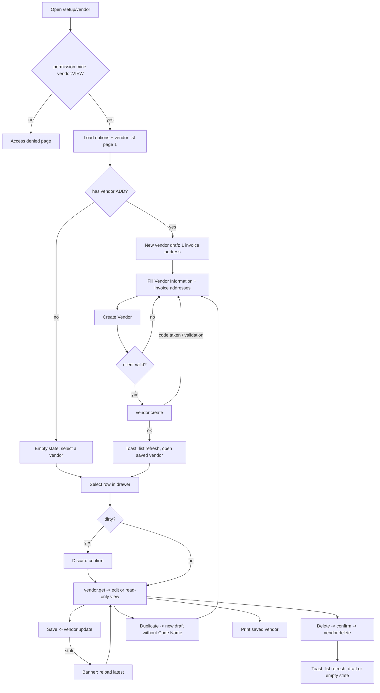

# UI specification: vendor

- Feature ID / revision: `vendor` / 4 (revision 4 = [draft row title and address card design](#revision-4-draft-row-and-address-card) on top of revision 3; revision 3 = [ADR-0021 changes](#revision-3-adr-0021) on top of revision 2 below)
- Status: revision 2 approved 2026-10-15 (revision 1 + owner answers Q-VEN-01/02/03; see the [TODO](../../../task/todo/vendor.md)); revision 3 approved 2026-10-16 with ADR-0021 ("...ทำ adr เเล้วเริ่มทำเลย"); revision 4 approved 2026-10-16 by the owner instruction quoted in [customer revision 3](../customer/ui-spec.md#revision-3-draft-row-and-address-card)
- Source: six owner-supplied screenshots (not Figma), 2026-10-15. Two pairs are byte-identical, so four unique images are kept in [source/](source/).
- Viewport / source dimensions: all images are 3840×2160 px. **Assumption:** device-pixel ratio 2, so the viewport is 1920×1080 CSS px. This is supported by the shell geometry, which matches the FE-UP-017 sources (sidebar 236, topbar 48 CSS px). All CSS values below are estimates unless marked as sampled.
- Inspection evidence: each image viewed with the image reader; detail regions cropped at full resolution (header, drawer, Vendor Information, address item, error states) on 2026-10-15. No Figma file or tokens were supplied.
- Owner request (2026-10-15): "หน้า Vendor flow คล้ายๆหน้า Customer เลย ช่วยทำ uxui spec ให้หน่อย" (the Vendor page flow is much like the Customer page; please write the UX/UI spec).
- Pattern feature: [customer](../customer/ui-spec.md) UI revision 1 (approved 2026-10-14; implemented in `frontend/src/features/customer/`), governed by [ADR-0018](../../../adr/0018-customer-master-partner-service.md). ADR-0018 §1 already says `backend-api-partner` will own **Vendor** in the future, but it does **not** define Vendor's data model, API or rules. Those need a new SA decision (see [data-fetching.md](data-fetching.md#requirements-for-the-sa-bundle)).
- Requirements / main flow: [main flow](#main-user-flow) below and the editable [vendor-flow.md](../../../diagram/vendor-flow.md). [Open questions](open-questions.md)
- Review bundle: this file, [design-system.md](design-system.md), [conventions.md](conventions.md), [form-guidelines.md](form-guidelines.md), [data-fetching.md](data-fetching.md), [error-handling.md](error-handling.md), [dependencies.md](dependencies.md), [testing.md](testing.md), [open-questions.md](open-questions.md); central TODO: [`document/task/todo/vendor.md`](../../../task/todo/vendor.md)

## Revision 4 (draft row and address card)

- Approval: the owner instruction of 2026-10-16 quoted in [customer revision 3](../customer/ui-spec.md#revision-3-draft-row-and-address-card) ("...รูปที่สองและสามเป็นแบบใหม่ของ invoice address ในทั้ง customer และ vendor set as default address ย้ายมาด้านบนแทน เลข 1 ด้วย..."), recorded as approval of vendor UI revision 4.
- Source: [rev4-01-address-card-no-default.png](source/rev4-01-address-card-no-default.png) (new card, unchecked) and [rev4-02-address-card-default-checked.png](source/rev4-02-address-card-default-checked.png) (new card, #1 checked). Viewed with the image reader on 2026-10-16. The draft-row bug is the one shown in customer [rev3-01](../customer/source/rev3-01-current-draft-row-issue.png).
- Frontend-only; no API, schema or rule change. Same shared components as customer revision 3, with Vendor wording. TODO IDs: FE-VEN-R4-001 … FE-VEN-R4-004.

| Area | Revision 4 behavior | Supersedes |
|---|---|---|
| Drawer draft row | Fixed title **"New vendor"**, subtitle "Not saved yet", "Draft" badge; never mirrors the typed Code Name or Name | revision 3 draft row (typed Code Name / Name); DV-02 |
| Address item | Same card as [customer revision 3](../customer/ui-spec.md#revision-3-draft-row-and-address-card): "#N" outside on the left; light gray rounded card without chevron or "Default" badge; first row = "Set as default address" (left) + red trash (right); always open; red border on errors (DV-12). Vendor keeps its **4-column grid capped at ~1220 px** (VD-03) inside the card | Address item accordion row, C-10 expanded/collapsed |
| Add button | Dashed "+ Add another invoice address"; count badge unchanged | - |
| Trash / read-only | #1 cannot be removed (trash shown disabled); #2+ removable; 1-10 items. Read-only: checkbox and trash disabled | trash hidden on #1 and in read-only |
| Default rule (unchanged, ADR-0019 / Q-VEN-03) | **0 or 1** default. The checkbox toggles freely; checking one unchecks the others; unchecking leaves no default. A new vendor starts with #1 **unchecked**, which matches rev4-01 | - |

## Revision 3 (ADR-0021)

- Source: [rev3-01-shared-header-reference.png](source/rev3-01-shared-header-reference.png) and [rev3-02-drawer-row-code-name.png](source/rev3-02-drawer-row-code-name.png) — the same images as customer revision 2 (ADR-0021: "vendor ใช้ภาพเดียวกัน").
- Governing decision: [ADR-0021](../../../adr/0021-partner-code-running-number-and-record-modes.md) (Accepted 2026-10-16).
- Behavior is identical to [customer revision 2](../customer/ui-spec.md#revision-2-adr-0021) (shared `features/partner/**`), with Vendor wording: title "Add Vendor" / the vendor's Name, "Vendor List N", buttons **Create Vendor**, Cancel, Save, Edit, Delete; Code Name required `*` and prefilled from `vendor.nextCode` (`{code:"V001"}`); `VENDOR_CODE_TAKEN` → field error + refetch; drawer rows bold Code Name / Name.
- Vendor keeps its own sections: one full-width **Invoice Address** card (no Shipping card, which the reference image shows for Customer), 4-column item grid, optional default (Q-VEN-03).
- Superseded: TC-VEN-04 header ("Add/Edit Vendor", single Create Vendor / Save button), TC-VEN-11 and Q-VEN-04 default (bold Name, Code Name second line), TC-VEN-16 Duplicate (Code Name now prefilled with the suggestion).

## Source and evidence

| # | File | SHA-256 (prefix) | Supplied as | State shown |
|---|---|---|---|---|
| S1 | [01-empty-drawer-open.png](source/01-empty-drawer-open.png) | `bc75ae4658f4a975` | images 1 and 2 (identical) | Add mode, empty form, drawer open. Labels "Default Currency\*", "First Name\*". One Invoice item #1, expanded, "Default" badge, "Set as default address" checked, label "Name/Company Name\*". |
| S2 | [02-empty-drawer-collapsed-no-default.png](source/02-empty-drawer-collapsed-no-default.png) | `89b3a37b11c09403` | image 3 | Drawer collapsed, form widened. Labels "Default Currency\*", "First Name\*". Item #1 has **no Default badge and the checkbox is unchecked**; label "Company Name\*". |
| S3 | [03-validation-errors-drawer-open.png](source/03-validation-errors-drawer-open.png) | `0f433747d2da76df` | images 4 and 5 (identical) | Drawer open, submit errors: Name, Currency, First Name, **Phone No. ("Phone No. is required")**, Email, and in item #1 Name/Company Name, Address, Country, City, Postcode. Item frame red. State/Province is not in error (Country is empty). Label "Currency\*". |
| S4 | [04-address-frame-error-drawer-collapsed.png](source/04-address-frame-error-drawer-collapsed.png) | `eb6e0fc1b7a482d5` | image 6 | Drawer collapsed. Item #1 frame red but **no field error**, no Default badge, checkbox unchecked. Labels "Currency\*", "First name\*", "Company Name\*". |

## Source quality

| Kind | What it covers |
|---|---|
| **Same as customer** (visual compare, not re-sampled) | Colors, field height 52, card/item radii, drawer ~319 px and toggle 24×40, badges, notched labels, error styling, dashed add button. Values in [customer design-system.md](../customer/design-system.md) |
| **Estimated from the image** | Address item 4-column grid, grid caps, title-row spacing |
| **Customer decisions reused** | Route pattern, toolbar, Delete button, edit/view modes, drawer rows, search, permissions UX, State/City as text, Country select, error copy, print, discard guard, responsive proposal (Q-CUS-01…06 answers) |
| **Existing code facts** | `AppShell` (FE-UP-017 Sidebar + Topbar), `SetupTabs`, shared `components/ui/*`, customer components, `permission.mine`, permission catalog leaf `vendor` (`backend-api-auth/src/permission/catalog.ts`), dashboard item `{ label: "Vendor", slug: "vendor" }` in the gateway router |
| **Needs SA (no approved contract)** | `vendor.*` procedures, Vendor/VendorAddress data model, field rules (Phone required?, default address), error codes |
| **Assumptions / proposals** (in [open questions](open-questions.md)) | DPR 2; label wording; Phone requirement; default-address behavior; drawer second line |
| **Not in source** | Edit mode, Delete, success feedback, server errors, loading/empty states, list paging, dirty-form confirmation, print, mobile/tablet layout. All follow the customer behavior. |

## Differences from Customer

This is the full list of what changes compared with the approved customer page. Everything else is the same.

| ID | Area | Customer | Vendor |
|---|---|---|---|
| VD-01 | Entity wording | "Add Customer", "Customer list {n}", "Create Customer", drawer "Customers", "Customer Information" | "Add Vendor", "Vendor list {n}", "Create Vendor", drawer "Vendors", "Vendor Information" (S1) |
| VD-02 | Address cards | Invoice **and** Shipping, side by side | **Invoice Address only**, one card at full content width (S1–S4) |
| VD-03 | Address item grid | 2 columns (card is half width) | **4 columns** inside a ~1220 px cap: Name/Company Name (1 col) + Tax ID (1 col); Address (4); Country (2) + State/Province (2); City (2) + Postcode (2). Measured: Name 306→613 and Tax ID 631→938 display px; Address 306→1578, the same in S1 and S2, so the grid is capped and does not widen with the drawer closed. |
| VD-04 | Phone No. | Optional | Optional (owner, Q-VEN-02). S3 "Phone No. is required" is not implemented. |
| VD-05 | Default address | First item is default; the default cannot be unchecked (P-01) | **Optional, at most one** (owner, Q-VEN-03): new items start unchecked (S2), ticking moves the default, it can be unticked, none is valid; the S4 red frame is not used |
| VD-06 | Labels | "Currency", "First name", "Name/Company Name" | Same as Customer (owner, Q-VEN-01) |
| VD-07 | Route, tab, sidebar | `/setup/customer`, Setup tab "Customer" | `/setup/vendor`, Setup tab **"Vendor"** placed right before "Customer" (sidebar order Vendor, Customer; Q-VEN-05), sidebar Partner Master › Vendor → `/setup/vendor` |
| VD-08 | Permission key | `customer:*` | `vendor:*` (the catalog leaf already exists; no catalog change) |
| VD-09 | API | `customer.*` (approved) | `vendor.*` (**requires-sa**, new) |

## Deviations from the design

These are the customer deviations (DV-01…DV-12 in the [customer spec](../customer/ui-spec.md#deviations-from-the-design-adr-0018-and-owner-decisions)) applied to Vendor, plus vendor-specific ones.

| ID | Design shows | Implement instead | Authority |
|---|---|---|---|
| DV-01 | Drawer title "Vendors" | Keep "Vendors" (correct here) | VD-01 |
| DV-02 | Draft row "New user / superadmin@example.com" | Bold line = the Name being typed (fallback "New vendor"); second line = the Code Name being typed (fallback "Not saved yet"); "Draft" badge | Customer DV-02 |
| DV-03 | Search placeholder "Search name or username..." | "Search name or code name..." | Customer DV-03 |
| DV-04 | State/Province and City are dropdowns ("Choose a country first") | **Closed (owner 2026-10-19):** dropdowns from the country's region list, as customer DV-04 | Customer DV-04 |
| DV-05 | Country is a plain empty input | Country dropdown (ISO 3166-1) | Customer DV-05 |
| DV-07 | No Delete button | Delete button (danger) for a saved vendor when the user has `vendor:DELETE`, with a confirm dialog | Customer DV-07 / Q-CUS-02 |
| DV-08 | Breadcrumb "Breadcrumbs Item › Breadcrumbs Item › Vendor" | `Home › Setup › Vendor`; the existing `SetupTabs` bar with a new active "Vendor" tab | Customer DV-08 |
| DV-09 | Excel icon looks enabled | Excel `aria-disabled` with tooltip "Excel export isn't available yet" | Customer DV-09 |
| DV-11 | Grey band behind the title row | Not implemented | Customer DV-11 |
| DV-12 | S3: item frame red **and** its fields red | Same rule as customer: frame red when any field inside has an error; each field shows its own error; collapsed item also shows "Has errors" | Customer DV-12 |
| DV-13 | SAMPLE-VENDOR-E is "Inactive" but its dot is green | Grey dot for inactive (as customer) | Design inconsistency |
| DV-14 | Drawer second line "V-0001 · Sample Vendor A Co., Ltd." | Second line = Code Name only (as customer; ADR-0018 records the owner's reading of this same sample). **Q-VEN-04** asks whether Vendor wants "Code Name · default invoice company name". | Customer decision |

Customer DV-06 (Shipping button text) and DV-10 (old AppShell) do not apply: there is no Shipping card, and the shell is already the FE-UP-017 Sidebar + Topbar shown in the source.

## Page structure and layout

All positions are CSS px estimates at 1920×1080 (display px of the 2000-wide preview ÷ 1.04).

| Region | Observed layout | Evidence |
|---|---|---|
| Sidebar, topbar | Existing `AppShell` (FE-UP-017). Breadcrumb `Home › Setup › Vendor` (DV-08). | S1–S4 |
| Setup tab bar | Existing `SetupTabs` with a new **Vendor** tab (VD-07) | customer pattern |
| Content area | Background `gms-page`; padding 24 px; ~40 px right with the drawer open; scrolls vertically | S1 |
| Page header row | Left: `<h1>` "Add Vendor" + "Vendor list {total}". Right: Print, Excel, gap, Duplicate (disabled in draft), Refresh, then "Create Vendor" (plus icon). Delete is added for a saved vendor (DV-07). | S1 |
| Vendor Information card | Same as customer: header with "Vendor Information" and the Active switch; 3-column grid capped ~1290 px, left-aligned. Row 1: Code Name, Name\*, Currency\*. "Basic Information". Row 2: First name\*, Middle name, Last name. Row 3: Phone No., Email\*. | S1, S2 |
| Invoice Address card | **Full content width** (VD-02). Header "Invoice Address" + count badge; divider; body padding 16; items stacked; full-width dashed "Add another invoice address" button (~42 px). | S1–S4 |
| Address item | Same accordion as customer (border, `gms-page` fill, header ~46 px with chevron, "#n", Default badge and/or trash). Body uses the **4-column grid capped at ~1220 px** (VD-03); the item frame itself spans the card. Last row: "Set as default address". | S1–S4 |
| Vendors drawer | Same as the customers drawer: ~319 px, pushes content, header "Vendors" + total + close, search, draft row, saved rows with dot, Name, second line, "Inactive" badge. | S1, S3 |
| Drawer toggle | Same 24×40 tab | S1–S4 |

Scrolling, sticky behavior and the responsive proposal are the same as customer ([customer spec](../customer/ui-spec.md#responsive-behavior-proposal-not-in-source-q-cus-05), approved default). Address-item rule for narrow widths: below ~900 px of item width the 4-column grid becomes 2 columns (Name + Tax ID share a row; Address full), below 600 px 1 column.

## Component inventory

The customer page already has every building block. To avoid copying, FE-VEN-001 **extracts** the customer components that Vendor also needs into a shared Partner Master module (`frontend/src/features/partner/`), parameterized by entity wording, permission key, address types and the item grid layout. Customer then imports them (no behavior change). See [conventions.md](conventions.md#extraction-from-customer).

| ID | Component | Source (after FE-VEN-001) | Vendor props / states | Evidence |
|---|---|---|---|---|
| C-01 | AppShell | `features/home/app-shell.tsx` (reuse) | breadcrumbs `[Home, Setup, Vendor]` | S1 |
| C-02 | SetupTabs | `features/setup/setup-tabs.tsx` (+1 tab) | "Vendor" → `/setup/vendor` | VD-07 |
| C-03 | PartnerPageHeader | from `customer-page-header.tsx` | entity labels; modes draft/edit/view/none; titles "Add Vendor" / "Edit Vendor" / "Vendor" | S1 |
| C-04 | Button, IconButton | `components/ui/button.tsx` (reuse) | — | S1 |
| C-05 | Card, CountBadge, Badge | `components/ui/card.tsx` (reuse) | — | S1 |
| C-06 | Switch | `components/ui/switch.tsx` (reuse) | — | S1 |
| C-07 | TextField / SelectField / PhoneField / LabeledCheckbox | `components/ui/*` (reuse) | Phone required flag per Q-VEN-02 (prop already exists) | S1, S3 |
| C-08 | PartnerInformationCard | from `customer-information-card.tsx` | title "Vendor Information" | S1 |
| C-09 | AddressListCard | from `address-list-card.tsx` | one type (`invoice`); full width; button "Add another invoice address" | S1 |
| C-10 | AddressItem | from `address-item.tsx` | new `layout="wide"` 4-column grid (VD-03); the customer keeps the 2-column layout | S1–S4 |
| C-11 | PartnerDrawer | from `customers-drawer.tsx` | "Vendors", "Close vendors panel", "Search vendors", empty/no-match copy | S1 |
| C-12 | DeleteDialog, DiscardChangesDialog | from customer | vendor copy (error-handling.md) | customer |
| C-13 | PrintView | from `customer-print-view.tsx` | title "Vendor {Name}"; invoice addresses only | customer |
| C-14 | AccessGuard, Toast, FormError banner | customer pattern | "You don't have access to Vendor" | customer |

### Header toolbar

Same as the [customer toolbar](../customer/ui-spec.md#header-toolbar) with `vendor:*` permissions and these labels: Print "Print saved vendor", Duplicate "Duplicate vendor" (toast "Copied from {Name}. Enter a code name if needed, then create the vendor."), Delete, **Create Vendor** (`Creating...`), **Save** (`Saving...`). Buttons without permission are hidden; Excel is the only disabled button.

### Vendors drawer list

Same as the [customers drawer list](../customer/ui-spec.md#customers-drawer-list): dot (green active / grey inactive + screen-reader text), line 1 Name, line 2 Code Name or "No code name" (Q-VEN-04), "Inactive" badge; server search on Name/Code Name, debounced 300 ms; 50 rows per page with infinite scroll and "Load more"; empty "No vendors yet"; no match `No vendors match "{q}"`; draft row only with ADD.

## Interaction and data

Every interaction in the [customer table](../customer/ui-spec.md#interaction-and-data) applies with "vendor" wording, `vendor.*` calls and `vendor:*` permissions. Vendor-specific rows:

| Interaction | Result |
|---|---|
| Open page | `/setup/vendor`; `permission.mine` checks `vendor:VIEW`; users with ADD start on a draft (Active on, **one Invoice item**, default) |
| Add / remove address | Invoice only; 1–10 items (customer limit, to be confirmed by SA); #1 has no trash |
| Set default | Optional (Q-VEN-03): new items unchecked; ticking moves the default; can be unticked; none is valid |
| Create / Save / Delete / Duplicate / Print / Refresh / discard guard | As customer, with `vendor.create/update/delete/get/list` and `VENDOR_*` error codes (names proposed, SA decides) |

Permission-driven UX: as the [customer table](../customer/ui-spec.md#interaction-and-data) with `vendor:VIEW/ADD/EDIT/DELETE`; Super Admin (`"ALL"`) gets everything.

## Main user flow

Screen-level flow. The editable flow is [vendor-flow.md](../../../diagram/vendor-flow.md); SA adds service interactions in its own sequence diagrams.

## States required

Same as the [customer states](../customer/ui-spec.md#states-required), with one address type. Shown in the source: empty draft (S1), drawer collapsed (S2), validation errors (S3), item error frame (S3, S4). S2/S4's "no default" state is pending Q-VEN-03.

## Accessibility

Same rules as [customer](../customer/ui-spec.md#accessibility): one `<h1>`, card `<h2>`, "Basic Information" `<h3>`, each address item a `<fieldset>` with legend "Invoice address #n", `aria-invalid` + `aria-describedby`, chevron `aria-expanded`, trash "Remove invoice address #2", disabled State/City skipped by Tab, Excel `aria-disabled`, non-modal `<aside aria-label="Vendors">`, modal dialogs with focus return, polite toasts. Default badge colors follow the owner's customer decision (Q-CUS-06).

## Dependencies and traceability

- Packages: none new ([dependencies.md](dependencies.md)).
- SA: required for `vendor.*` and the Vendor data model ([handoff](../../../coordination/handoffs/vendor-sa.md)); infra: no new container expected (same `backend-api-partner`), SA confirms.
- TODO IDs: FE-VEN-001 … FE-VEN-013 in the [central TODO](../../../task/todo/vendor.md).

## Revision history

| Revision | Date | Change |
|---|---|---|
| 4 | 2026-10-16 | Fixed draft row title "New vendor"; new address card (outside "#N", default checkbox + trash on top, no accordion/badge). Approved by the owner instruction of 2026-10-16. |
| 2 | 2026-10-15 | Owner answers Q-VEN-01 (Customer labels), Q-VEN-02 (Phone optional), Q-VEN-03 (default optional, starts unchecked). Approved for implementation. |
| 1 | 2026-10-15 | Initial analysis of six screenshots (four unique) against the approved customer UI revision 1. Status pending-review. |
