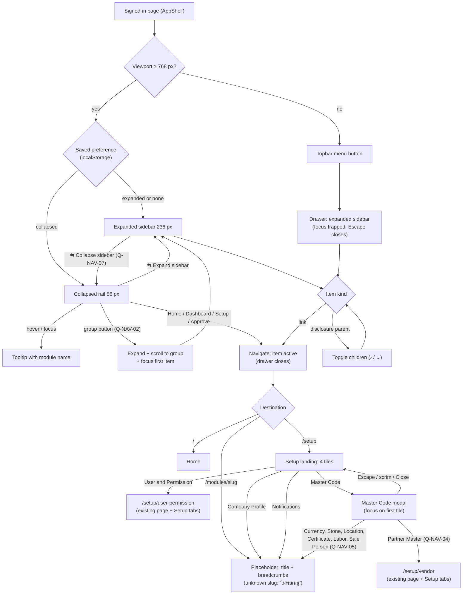

# App navigation flow

- **Feature / UI revision / SA revision:** `app-navigation` / 1 (**pending-review**) / none (no service interaction)
- **Source:** screenshots in [source/](../apps/frontend/app-navigation/source/); UI spec [app-navigation/ui-spec.md](../apps/frontend/app-navigation/ui-spec.md)
- **Last updated:** 2026-10-15 (ui-spec, revision 1)

Main user flow for the global sidebar (expanded, collapsed rail, mobile drawer), the Setup landing page and the
Master Code modal. Written by ui-spec from the screenshots; transitions not shown in the source are proposals
and reference their open question. There is no service call in this flow (static navigation); the session guard
is the existing `AppShell` behavior.

## Notes

- Active state: Setup is active on `/setup`, `/setup/*` and the Setup-owned placeholders; a disclosure child's
  parent opens automatically on load/navigation.
- Badges (red dots) are not part of this flow in revision 1 (Q-NAV-06, deferred SA topic).
- Permission-based hiding is not part of this flow (Q-NAV-11); destination pages keep their own access checks.
- SA refines service interactions only if a later revision adds badges or menu permissions; it does not duplicate
  this main flow.
