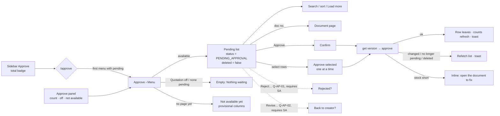

# Main flow: approve-center (UI revision 1, pending-review)

Approve Center lists documents in `PENDING_APPROVAL` per document type and approves them through each document's existing `approve` procedure. Dashed edges are open questions (Q-AP-01/02/07) and are not designed yet. SA refines service interactions in its own bundle.

Details: [ui-spec](../apps/frontend/approve-center/ui-spec.md), [data-fetching](../apps/frontend/approve-center/data-fetching.md), [open questions](../apps/frontend/approve-center/open-questions.md).
