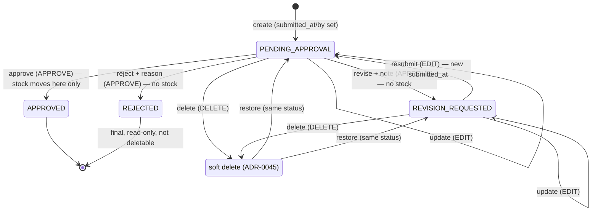

# Status flow: approve-center review (SA revision 1, 2026-11-07, approved 2026-11-07)

Status model for Reserve, Purchase Order, Purchase, Memo Receive, Memo Return, Memo Out and Memo Out Return ([ADR-0046](../adr/0046-approval-review-status-and-approve-center-api.md), decisions D1–D9). Detailed sequences: [sequence-diagram](../apps/backend/master/approve-center/sequence-diagram.md). UI flow: [approve-center-flow](approve-center-flow.md).

- Only `PENDING_APPROVAL` (not deleted) appears in Approve Center and in `approval.summary` counts.
- A resubmitted document returns to the end of the oldest-first queue and shows its last Revise note.
- Load to Stock, Merge/Split Stock and Transfer Location adopt the same model when they are designed (D20).
