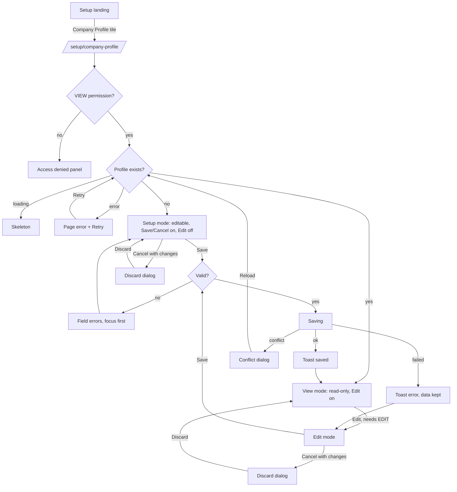

# Main flow: company-profile

- UI revision: 1 (pending-review); spec: [ui-spec.md](../apps/frontend/company-profile/ui-spec.md)
- Service interactions are refined by SA ([handoff](../coordination/handoffs/company-profile-sa.md)); this file keeps the user flow only.

Open transitions (see [open questions](../apps/frontend/company-profile/open-questions.md)): what Print and Excel produce (Q-CP-07); who has EDIT (Q-CP-10).
