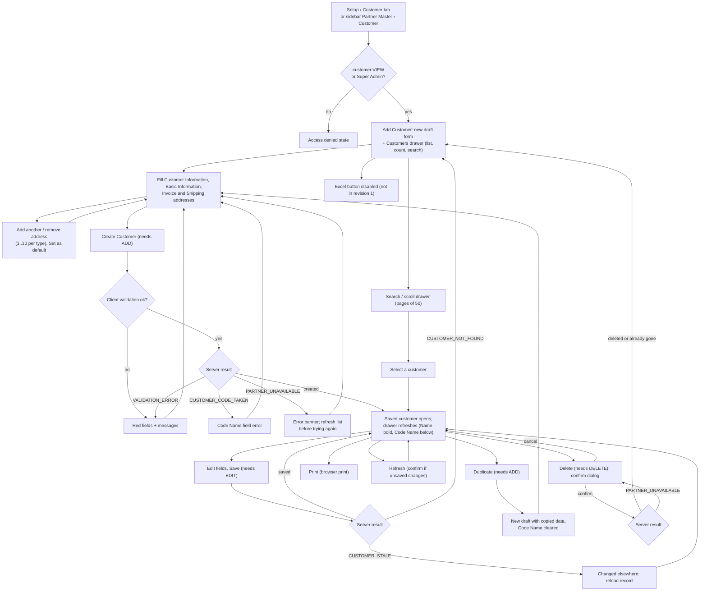

# Customer flow

- **Feature / UI revision / SA revision:** `customer` / 1 / 1 (SA pending-review)
- **Source:** [ADR-0018](../adr/0018-customer-master-partner-service.md) (Accepted 2026-10-14), screenshots in [source/](../apps/frontend/customer/source/); UI spec `document/apps/frontend/customer/` (ui-spec, in progress)
- **Last updated:** 2026-10-14

Main user flow for Setup › Customer (`/setup/customer`). Service interactions are in the
[partner + gateway sequence diagrams](../apps/backend/partner/customer/sequence-diagram.md);
they are not duplicated here. ui-spec may refine screen-level states in the UI spec.

