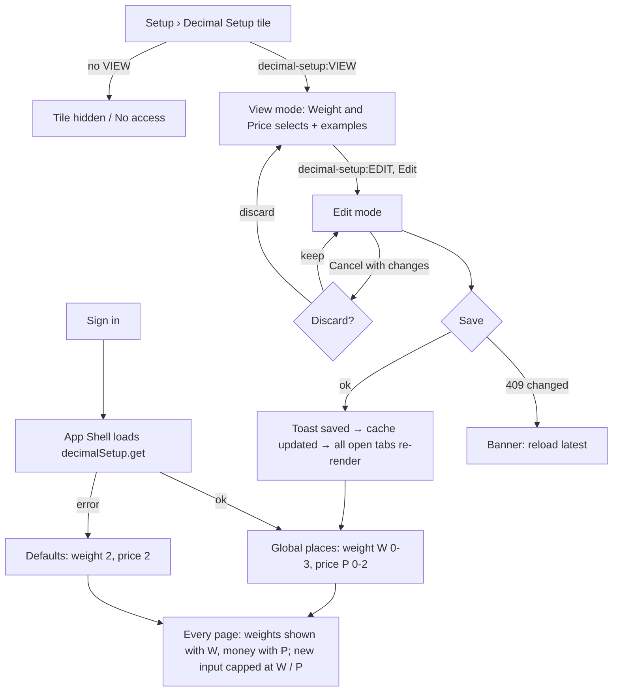

# Main flow: decimal-setup (UI revision 2 / SA revision 1, pending-review)

Sequence detail: [sequence-diagram](../apps/backend/master/decimal-setup/sequence-diagram.md). Decision: [ADR-0038](../adr/0038-global-decimal-setup.md).

Not affected by the setting: pcs, percentages, exchange and currency rates, stored values and server totals (2 dp).
