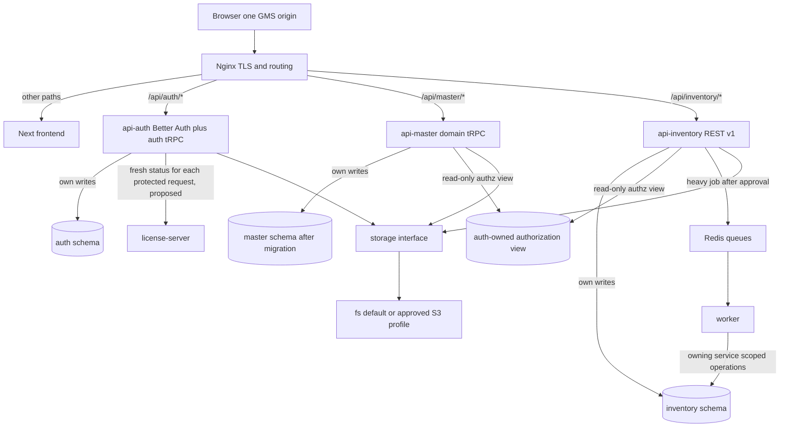

# GMS platform request and migration flow (proposed, SA revision 1)

Source: [GMS spec v1.1](../gms-platform-spec.md); [ADR-0025](../adr/0025-gms-domain-routing-and-trpc.md), [ADR-0026](../adr/0026-gms-access-tokens-and-live-authorization.md). No UI revision selected. This is an architecture flow, not a replacement for the accepted [login](login-flow.md), [license](license-flow.md), or existing feature flows until cutover is approved.

1. Login continues through Better Auth; auth issues distinct short access JWT and rotating refresh credential after eligibility checks.
2. A protected request verifies the JWT locally in its domain API and reads current account/session/grants from the auth-owned read-only view. The proposed license path asks auth for a fresh signed remote decision. Explicit revoked/expired state denies. On a transient outage, auth may use the last signed eligible result only until the earlier of its expiry or the fixed last-success timestamp plus `LICENSE_OFFLINE_GRACE_DAYS` (0–7, default 2); otherwise it returns 503. Remote revocation during an outage may remain unknown within that bound. This revises the current seven-day grace only after the ADR/spec exception and remote contract are approved.
3. Domain API validates input, authorizes exact action, executes its own schema transaction, returns bounded data and a common error envelope. Nginx adds request ID; frontend never treats menu visibility as authorization.
4. Before cutover, the legacy Next proxy/gateway path remains usable for rollback. Move one domain procedure/client at a time. Remove legacy routes only after parity, capacity and rollback are recorded.

The owner selected next-request local and online-remote revocation, then requested configurable outage handling with a two-day default on 2026-10-20. The architecture is still a proposed SA revision. [Auth sequence](../apps/backend/auth/gms-platform/sequence-diagram.md), [master sequence](../apps/backend/master/gms-platform/sequence-diagram.md), [inventory sequence](../apps/backend/inventory/gms-platform/sequence-diagram.md) show error paths.
