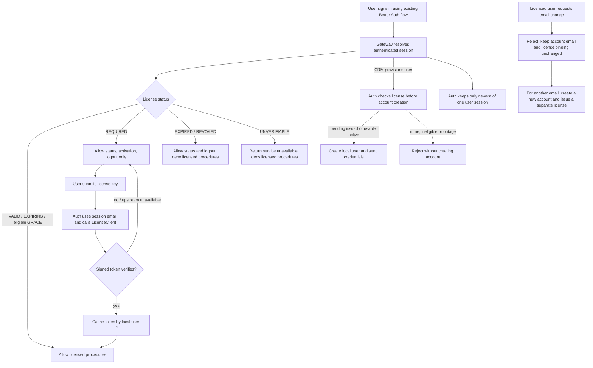

# License enforcement and activation flow (backend proposal)

- Status: proposed, pending SA review `auth-license` revision 2; revision 1 approval recorded separately
- Source: [license spec](../spec/0006-license.md)
- Backend contract: [auth license integration](../apps/backend/auth/license-integration/architecture.md)

This document describes backend states only. UI routes, redirects, screens and banner are
outside this revision. License transfer is unsupported; proposed JWT defaults remain pending review. See
the [detailed sequence](../apps/backend/auth/license-integration/sequence-diagram.md).
