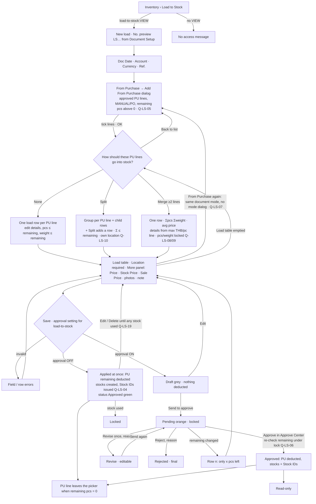

# Main flow: load-to-stock (UI revision 1, draft)

Load to Stock takes lines of approved Purchases (MANUAL / PO rows, which have no Stock ID since [ADR-0051](../adr/0051-purchase-lines-without-stock-id.md)) into stock, fully or partly. A PU line stays available until its remaining pcs is 0. Approval follows [ADR-0050](../adr/0050-approval-setting-draft-send-to-approve.md).

Spec: [ui-spec](../apps/frontend/load-to-stock/ui-spec.md). Questions: [open-questions](../apps/frontend/load-to-stock/open-questions.md). Service design: [SA revision 1, pending-review](../apps/backend/inventory/load-to-stock/architecture.md) ([sequence diagrams](../apps/backend/inventory/load-to-stock/sequence-diagram.md), [ADR-0052](../adr/0052-load-to-stock-in-backend-api-inventory.md)), service `backend-api-inventory`; SA refines service interactions without duplicating this flow. Nodes marked **(Q-LS-nn)** follow an unanswered default.

## Phase 2 (SA revision 2, Proposed)

Own stock in From Stock (one list, holds through inventory): main sequences in [sequence-diagram § Phase 2](../apps/backend/inventory/load-to-stock/sequence-diagram.md#phase-2-sa-revision-2-proposed) (8 picker merge, 9 Quotation copy, 10 acquire → local, 11 edit/delete release, 12 Memo Out Return). Not copied here.
