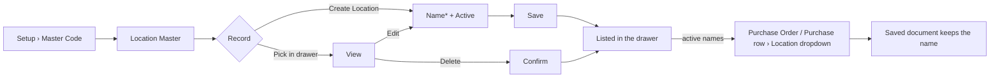

# Location Master — main user flow (UI rev 1, pending-review)

Unknowns: Q-LM-01…05 in the [ui-spec](../apps/frontend/location-master/ui-spec.md#open-questions). Service interactions: [sequence-diagram](../apps/backend/master/location-master/sequence-diagram.md).
