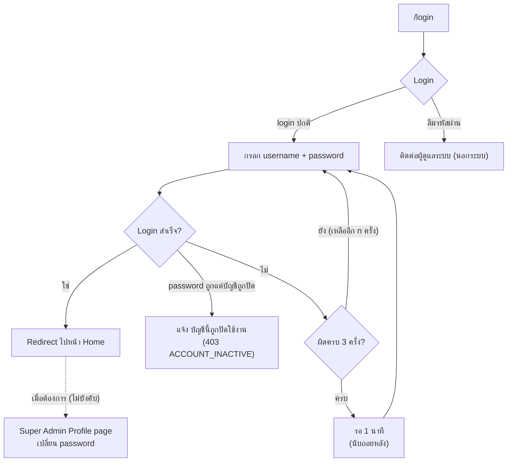
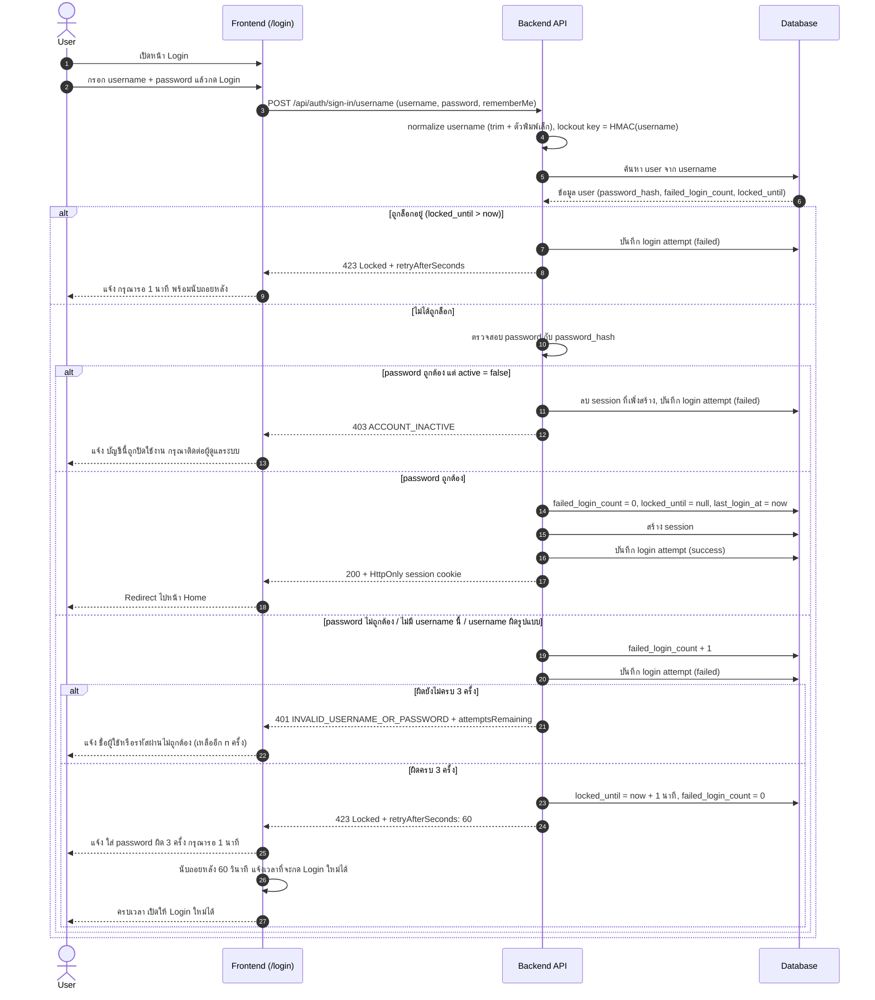
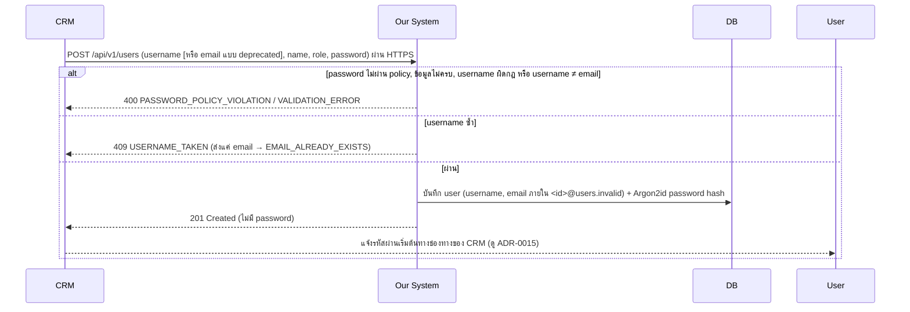
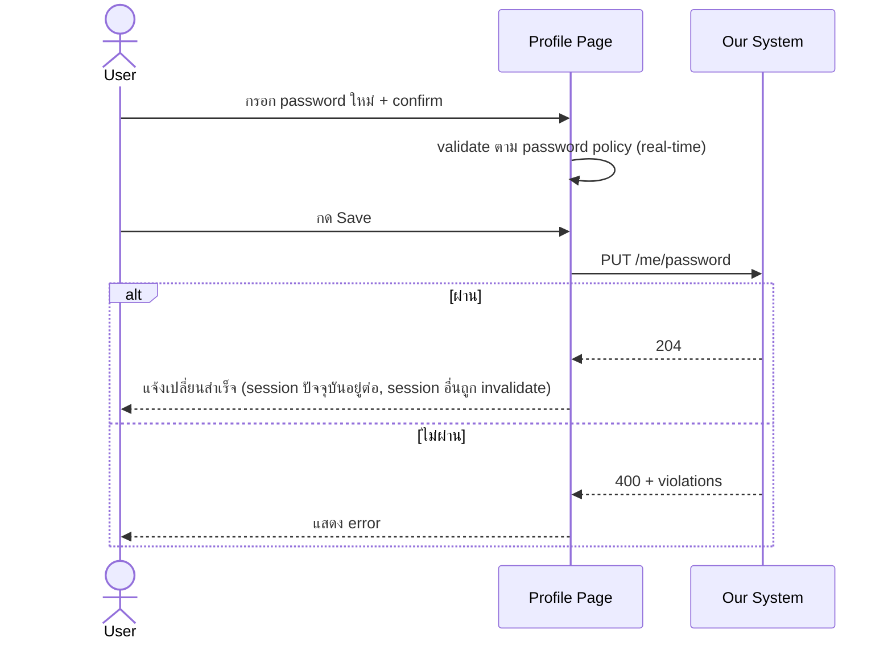

# Login Flow Diagrams

- **Last updated:** 2026-10-15 ([ADR-0020](../adr/0020-username-login-and-permission-matrix-v2.md): login ด้วย username, ปิด `/sign-in/email`, เพิ่มกรณีบัญชีถูกปิดใช้งาน); 2026-10-12 ([ADR-0015](../adr/0015-remove-forgot-password-and-email.md): เอา forgot password และ email ออก)
- **ต้นฉบับ:** Excalidraw (แนบลิงก์ไฟล์ต้นฉบับที่นี่)

> Diagram เขียนด้วย Mermaid แสดงผลได้ใน GitHub, GitLab, VS Code (ติดตั้ง extension Markdown Preview Mermaid)

## 1. ภาพรวม Flow หน้า /login

ล็อกบัญชี 1 นาทีเมื่อใส่ password ผิดครบ 3 ครั้ง ดู [ADR-0012](../adr/0012-change-flow-login.md)

## 2. Login และการล็อกบัญชีชั่วคราว

## 3. สร้าง User ผ่าน CRM

## 4. Forgot Password (ยกเลิกแล้ว)

เอาออกตาม [ADR-0015](../adr/0015-remove-forgot-password-and-email.md) ผู้ใช้ที่ลืมรหัสผ่านติดต่อผู้ดูแลระบบนอกระบบ

## 5. เปลี่ยน Password ที่ Profile Page

## หมายเหตุ

Flow ต้นฉบับมีส่วนที่เป็นสีจาง (popup บังคับเปลี่ยนรหัสหลัง login ครั้งแรก
และ log out หลัง save) diagram ข้างบนวาดตามการตัดสินใจล่าสุดใน ADR-0011
ซึ่งเลือก Profile page แทน popup ตาม ADR-0011
