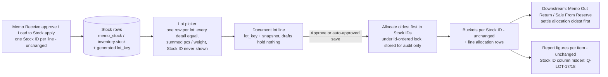

# Flow: pick and deduct stock by Lot (lot-based-stock, SA revision 1, pending-review)

The main user flow is maintained in the service bundle, not copied here:

- Pick a lot (From Stock): [sequence-diagram §1](../apps/backend/shared/lot-based-stock/sequence-diagram.md#1-pick-a-lot-from-stock-quotation--reserve--memo-out--sale)
- Approve with FIFO allocation: [§2](../apps/backend/shared/lot-based-stock/sequence-diagram.md#2-approve-a-memo-out-with-memo-stock-lot-lines-allocation-fifo)
- Return part of a lot line: [§3](../apps/backend/shared/lot-based-stock/sequence-diagram.md#3-memo-out-return-of-part-of-a-lot-line-settle-oldest-first)
- Own-stock lot holds: [§4](../apps/backend/shared/lot-based-stock/sequence-diagram.md#4-reserve-with-own-stock-lot-lines-pre-read--allocate--unchanged-hold-put)
- Sale consumption: [§5](../apps/backend/shared/lot-based-stock/sequence-diagram.md#5-sale-inventory-from-stock-lot-line-and-from-reserve-line)
- Legacy documents: [§6](../apps/backend/shared/lot-based-stock/sequence-diagram.md#6-legacy-document-no-conversion)

ADR: [ADR-0055](../adr/0055-lot-based-stock-picking-and-allocation.md) · TODO: [lot-based-stock](../task/todo/lot-based-stock.md)
