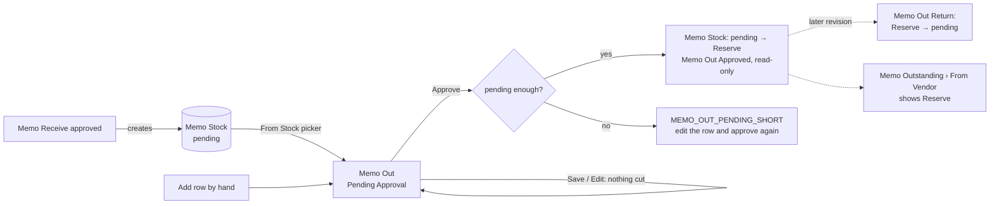

# Main flow: memo-out (SA revision 2, approved 2026-10-31)

Memo Out sends stones to a customer on memo. Stock rows come from **From Stock**, which is Memo Stock (stones borrowed from vendors through approved Memo Receives) until our own stock exists. Rows added by hand cut nothing.

Details: [sequence](../apps/backend/master/memo-out/sequence-diagram.md), [database](../apps/backend/master/memo-out/database-diagram.md), [SA decisions](../apps/backend/master/memo-out/decisions.md).
