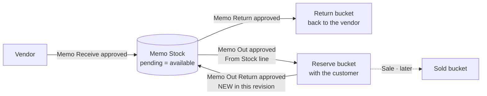
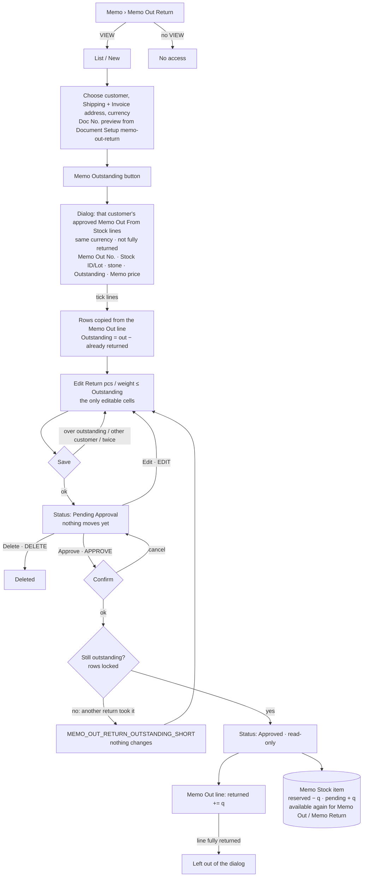

# Main flow: memo-out-return (UI revision 4 / SA revision 2, approved 2026-10-31)

Memo Out lends our goods to a customer. Memo Out Return brings them back into our own store. Owner 2026-10-31 (verbatim): "memoout คือการนำของของเราไปให้เขายืม ปุ่ม from stock คือ stockเรา ที่ตอนนี้ยังไม่มี และ ของในคลัง memo ตอนนี้จึงจะเเสดงของในคลัง memo ก่อน สิ่งที่จะให้ทำคือ หน้า memo out return คือนำของๆเราที่ทำ memo out กลับมาเข้าคลังตัวเอง กดที่ปุ่มmem outstanding จะสามารถดูของที่ทำmemo out ออกไปได้เเล้วเลือกเพื่อนำกลับเข้ามาคืนคลังตัวเอง".

Sequences: [sequence-diagram](../apps/backend/master/memo-out-return/sequence-diagram.md). Tables: [database-diagram](../apps/backend/master/memo-out-return/database-diagram.md). Decision: [ADR-0033 revision 3](../adr/0033-memo-documents-in-master-service.md). Questions: [open-questions](../apps/frontend/memo-out-return/open-questions.md) Q-MOR-11…18.

## Whole memo cycle (where each document moves the quantity)

Only Memo Out rows that came from From Stock can be returned; manual Memo Out rows are never listed (Q-MOR-13, owner 2026-10-31).

## Memo Out Return page

Not in this revision: our own stock (inventory service, ADR-0027), the Memo Outstanding › Customer report page, reversing an approved return, line photos.
