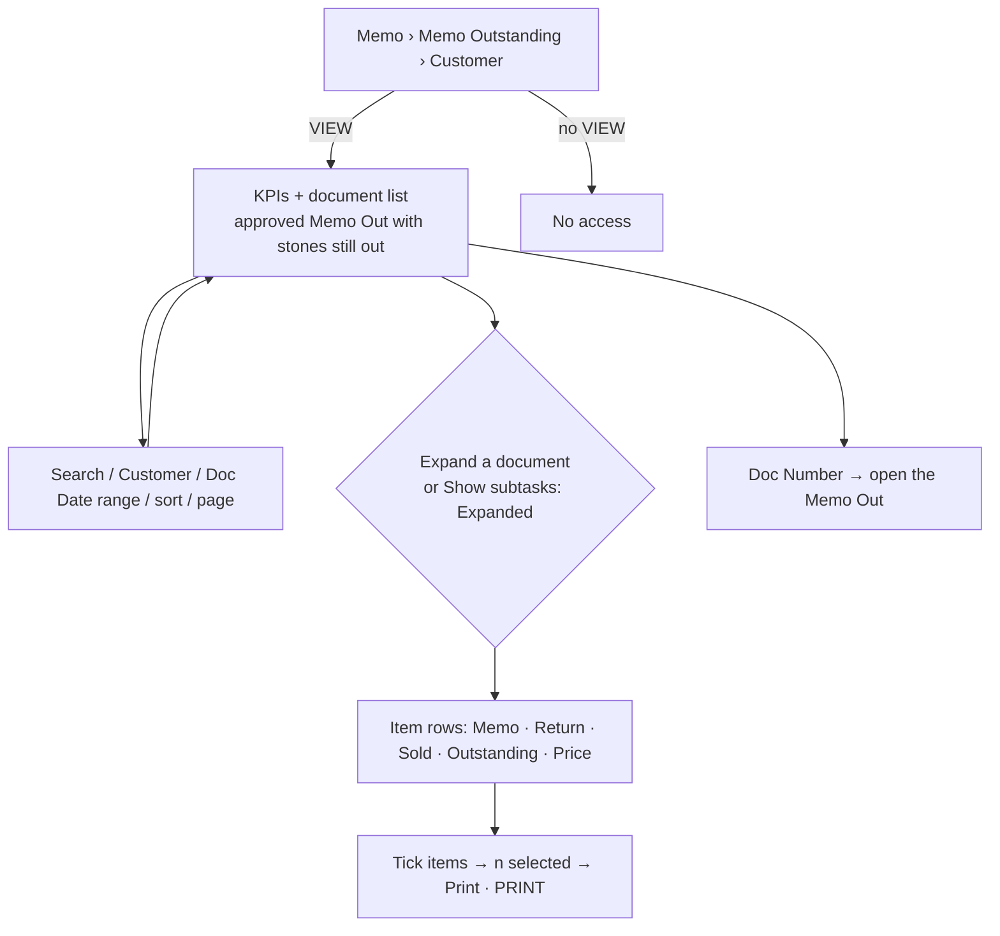
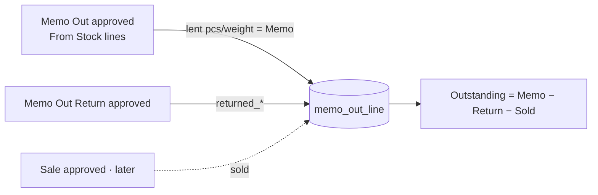

# Main flow: memo-outstanding-customer (UI revision 1 / SA revision 1, approved 2026-11-03)

This page is read-only. It covers each approved Memo Out: what we lent the customer, what came back, and what is still out. Spec: [ui-spec](../apps/frontend/memo-outstanding-customer/ui-spec.md). Decision: [ADR-0039](../adr/0039-memo-outstanding-customer-report.md).

## Where the numbers come from

