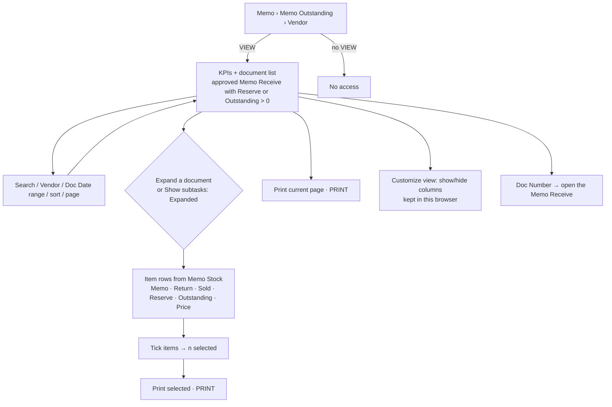
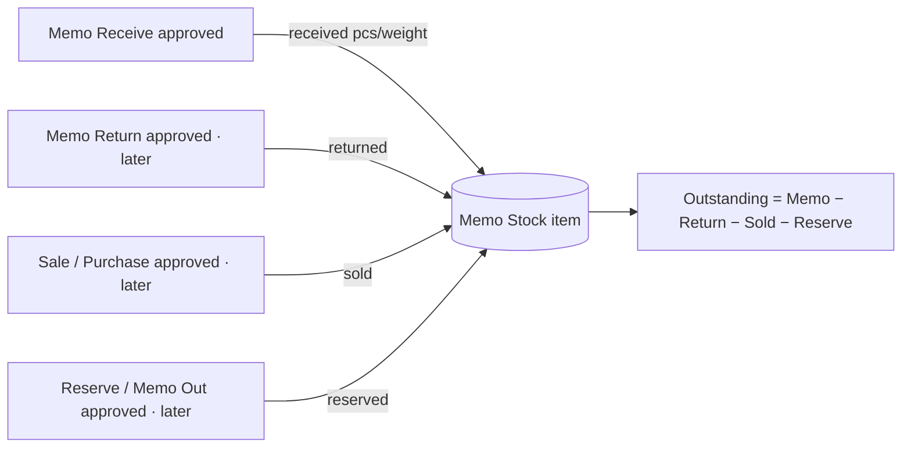

# Main flow: memo-outstanding-vendor (UI revision 1 / SA revision 1, approved 2026-10-29)

This page is read-only. It covers each approved Memo Receive: how much came in, where it went, and what is left. Spec: [ui-spec](../apps/frontend/memo-outstanding-vendor/ui-spec.md). Sequences: [sequence-diagram](../apps/backend/master/memo-outstanding-vendor/sequence-diagram.md). Decision: [ADR-0035](../adr/0035-memo-outstanding-vendor-report.md).

## Where the numbers come from

Revision 1 has a writer for Memo only, so Return, Sold and Reserve are 0. The labels marked "later" depend on Q-MOV-04.
