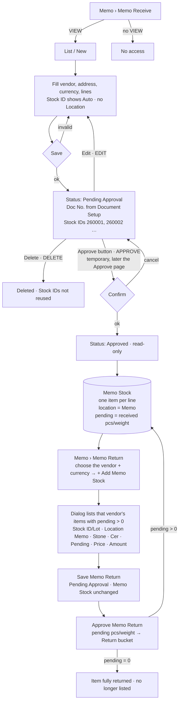

# Main flow: memo-receive → Memo Stock → Memo Return (UI revision 3 / SA revision 1, approved 2026-10-29)

Owner flow 2026-10-29: Memo Receive brings stones borrowed from a vendor into Memo Stock, and Memo Return sends Memo Stock items back to that vendor ([memo-return-flow](memo-return-flow.md)). Technical sequences: [sequence-diagram.md](../apps/backend/master/memo-receive/sequence-diagram.md). Decision: [ADR-0034](../adr/0034-memo-receive-approval-and-memo-stock.md).

Status of each step (2026-10-30): every step is built. Memo Receive and Memo Stock come from this revision. The Memo Return page came from memo-return SA revision 2 (PR #59). Pending is reduced when the Memo Return is approved, not when it is saved (owner Q-MR-15), and the quantity moves into the Return bucket (ADR-0035). Details: [memo-return-flow.md](memo-return-flow.md).
