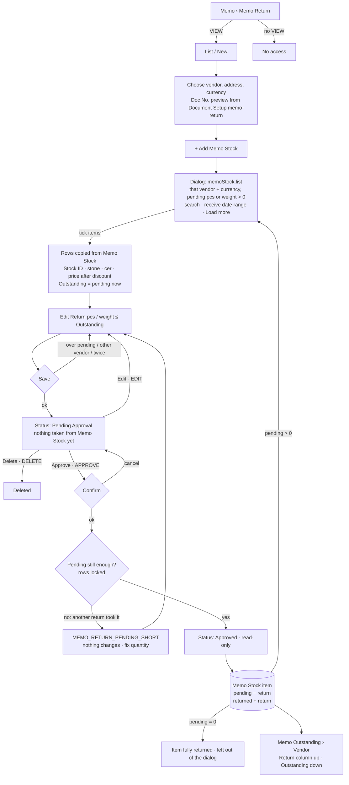

# Main flow: memo-return (UI revision 1 / SA revision 2, as built 2026-10-30)

Memo Return sends Memo Stock items back to their vendor. Memo Stock is filled by approved Memo Receives ([memo-receive-flow](memo-receive-flow.md)). This diagram records the system as implemented (PR #59 merged into `feat/30-10-26-memo-outstanding-vendor`, plus the merge fix that fills the Return bucket). Spec: [ui-spec](../apps/frontend/memo-return/ui-spec.md). Sequences: [sequence-diagram](../apps/backend/master/memo-return/sequence-diagram.md). Tables: [database-diagram](../apps/backend/master/memo-return/database-diagram.md). Decisions: [ADR-0034](../adr/0034-memo-receive-approval-and-memo-stock.md) (Q-MR-15) and [ADR-0035](../adr/0035-memo-outstanding-vendor-report.md) (buckets).

## Rules

- Saving reserves nothing. Two Pending returns may name the same item, and approval re-checks the pending quantity under a row lock, so only quantities that still exist are taken.
- Approval moves the quantity from `pending_*` to `returned_*` in one UPDATE. The CHECK `memo_stock_balance` (pending = received − returned − sold − reserved) holds after every approval.
- Only Pending Approval documents can be edited or deleted. An approved return can't be undone in this revision.
- Permissions: leaf `memo-return` VIEW / ADD / EDIT / DELETE / APPROVE. The dialog read `memoStock.list` accepts `memo-return:VIEW` or `memo-receive:VIEW`.
