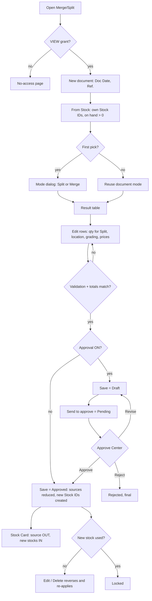

# Flow: merge-split (UI revision 1, pending-review)

Main user flow of Inventory › Merge/Split ([ui-spec](../apps/frontend/merge-split/ui-spec.md)). SA adds service interactions in its own bundle without duplicating this flow.

Open transitions: Q-MS-14 (Cancelled vs Delete/Reject), Q-MS-15 (pending holds), Q-MS-16 (re-convert results).
