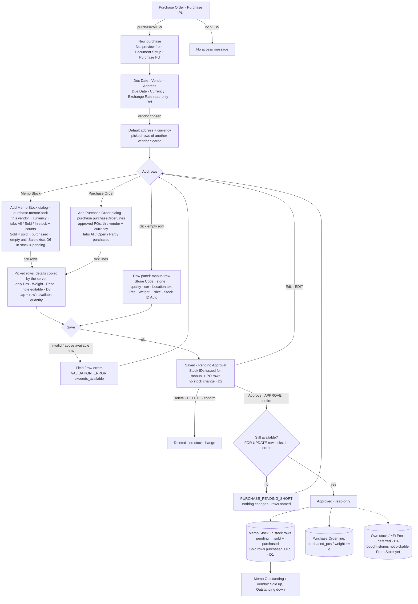
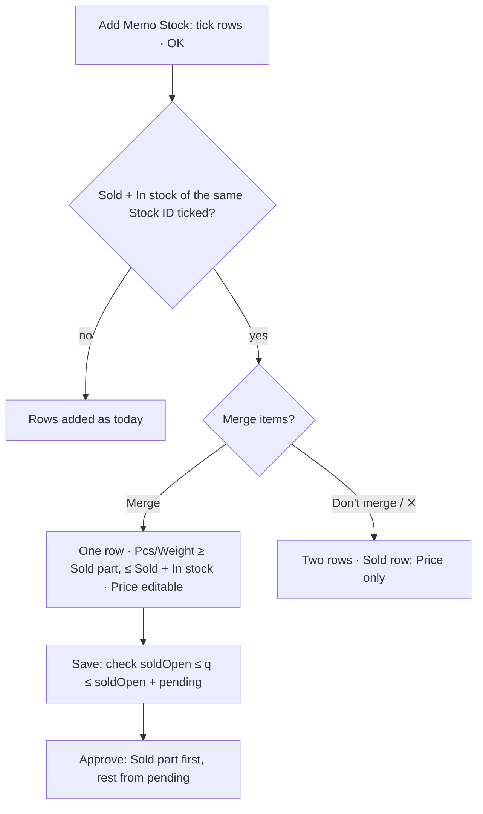

# Main flow: purchase (UI revisions 1–2, SA revision 1 approved 2026-11-04)

A Purchase (PU) records stones bought from a vendor. Its rows come from three places:

- that vendor's **Memo Stock**, which approved Memo Receives fill (see [memo-receive-flow](memo-receive-flow.md));
- **approved Purchase Order lines** that still have something outstanding (see [purchase-order-flow](purchase-order-flow.md));
- rows **keyed in** by hand.

Spec: [ui-spec](../apps/frontend/purchase/ui-spec.md). Open questions: [open-questions](../apps/frontend/purchase/open-questions.md). Service design: [SA rev 1 decisions](../apps/backend/master/purchase/decisions.md), with the [sequences](../apps/backend/master/purchase/sequence-diagram.md) and [ADR-0042](../adr/0042-purchase-document-and-stock-deduction.md).

Nodes marked **(Dn)** are SA defaults the owner may change ([list](../apps/backend/master/purchase/decisions.md#sa-defaults--owner-may-change)).

## Rules

- **Owner, 2026-11-04:**
  - PU and PO have the same shape, and on picked rows only pcs, weight and price change.
  - The Memo Stock button cuts memo stock.
  - The Purchase Order button cuts the outstanding of the PO being bought in.
- **Established elsewhere:**
  - The number comes from Document Setup key `purchase` (code PU), and the permission leaf is `purchase`.
  - There is one Exchange Rate per currency.
  - Stock moves at approval of the pulling document (Q-MR-15). This is the default D2 for Purchase.
- **Not in revision 1:**
  - un-approve;
  - payable posting;
  - the Purchase Outstanding report;
  - own stock;
  - a Sale document, which is what makes items "Sold to customers";
  - piece type (Pair / Parcel / Single);
  - line photos.

## Revision 3 (proposed 2026-11-05): merge Sold + In stock

Sources: [ui-spec › Revision 3](../apps/frontend/purchase/ui-spec.md#revision-3-merge-the-sold-and-in-stock-parts-of-one-item-pending-review), [ADR-0043](../adr/0043-purchase-merged-memo-stock-line.md).
