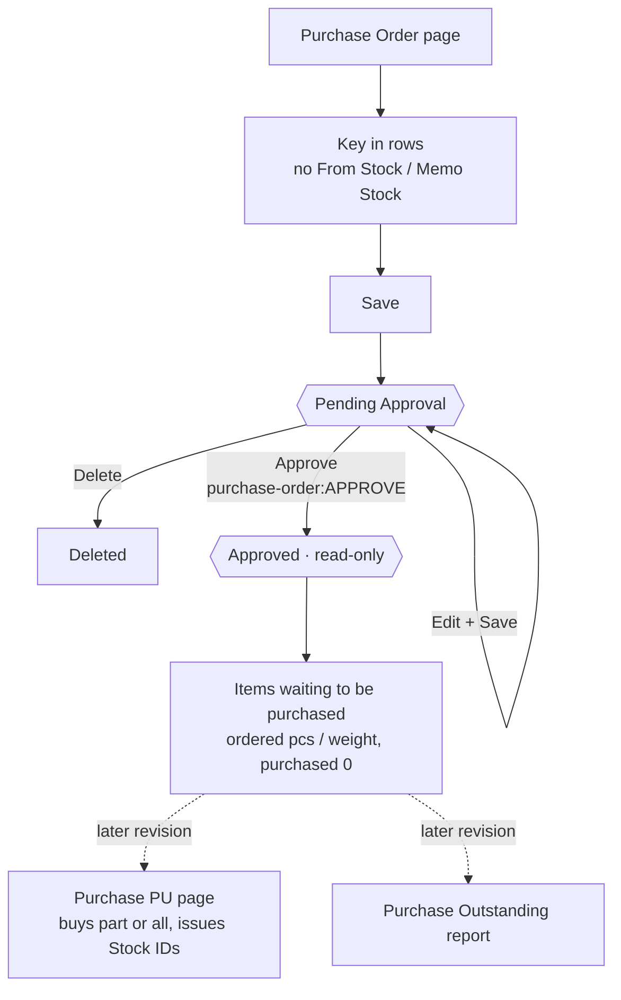

# Main flow: Purchase Order (revision 1, approved 2026-11-04)

Sources: [ui-spec](../apps/frontend/purchase-order/ui-spec.md), [SA decisions](../apps/backend/master/purchase-order/decisions.md), [ADR-0041](../adr/0041-purchase-order-document.md).
