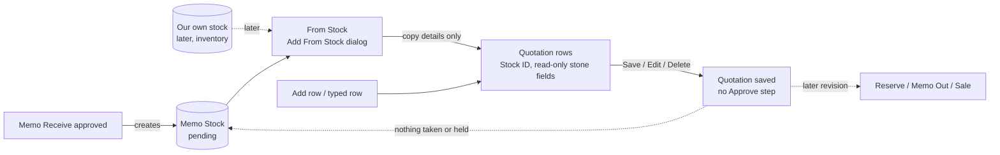

# Main flow: quotation From Stock (SA revision 2, approved 2026-11-03)

A quotation is an offer. From Stock copies a stone's details into it and takes nothing (owner 2026-11-03). From Stock is Memo Stock until our own stock exists.

- Memo Stock pending and Memo Outstanding never change because of a quotation.
- The same stone can be on several quotations at once.

Details: [SA decisions](../apps/backend/master/quotation/decisions.md#sa-revision-2-2026-11-03--from-stock-approved), [sequence](../apps/backend/master/quotation/sequence-diagram.md), [database](../apps/backend/master/quotation/database-diagram.md), [ADR-0038](../adr/0038-quotation-from-stock.md).
