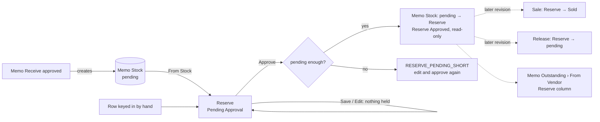

# Main flow: reserve (SA revision 1, approved 2026-11-02)

A Reserve holds stones for a customer until they are sold. From Stock is Memo Stock until our own stock exists. Rows keyed in by hand hold nothing.

Details: [SA decisions](../apps/backend/master/reserve/decisions.md), [sequence](../apps/backend/master/reserve/sequence-diagram.md), [database](../apps/backend/master/reserve/database-diagram.md).
