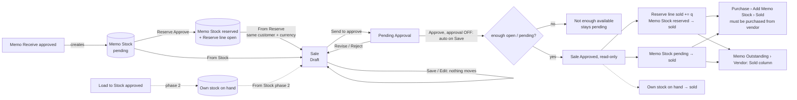

# Main flow: sale (UI revision 1, pending-review)

A Sale sells stones to a customer. Rows come from **From Reserve** (open lines of the customer's approved Reserves) or **From Stock** (Memo Stock now; own stock from Load to Stock in phase 2, Q-SL-01). Saving moves nothing; stock moves at Approve (ADR-0050). Dashed edges are later revisions. SA refines the service interactions in its own sequence diagram without duplicating this flow.

Service interactions (SA rev 1, pending-review): [inventory/sale sequence diagrams](../apps/backend/inventory/sale/sequence-diagram.md) and [ADR-0054](../adr/0054-sale-document.md) — Sale in `backend-api-inventory`; the stock effects above are applied by master in one idempotent call at Approve (or auto-approved Save).

Open transitions: Q-SL-02 (service placement), Q-SL-03 (reservation consumption), Q-SL-09 (approval), Q-SL-16 (no reversal) in [open questions](../apps/frontend/sale/open-questions.md). UI: [ui-spec](../apps/frontend/sale/ui-spec.md).
