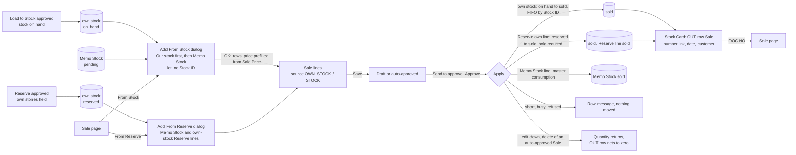

# Main flow: sale-own-stock (addendum A to Sale UI revision 1)

The Sale page's **From Stock** button now offers the stock loaded by **Load to Stock** (own stock) first, then Memo Stock, in the same dialog. A saved Sale takes the stones out of stock when it is applied; the Stock Card shows the OUT row. The base Sale flow is [sale-flow](sale-flow.md); the service side is drawn in the [sequence diagram](../apps/backend/inventory/sale-own-stock/sequence-diagram.md) and the decision in [ADR-0058](../adr/0058-sale-own-stock-from-load-to-stock.md).

Open decisions (defaults applied): [SQ-SO-01…12](../apps/backend/inventory/sale-own-stock/decisions.md#owner-questions): Reserve own-stock lines in this revision, Stock ID hidden, price prefill, own-only Sale without master, cost not in the ledger.
