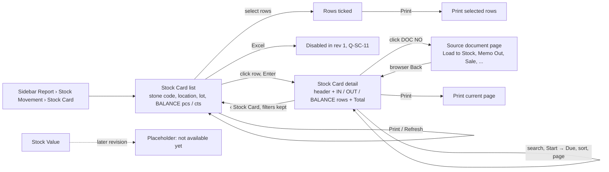

# Main flow: stock-card (UI revision 1, pending-review)

Stock Card is a read-only report. The list shows the remaining stock (BALANCE) per stone code + location + lot; a row opens the transactions of that card (IN, OUT, running BALANCE, totals); a document number opens the source document. Dashed edges and unknown transitions are open questions. SA refines the service side in its own sequence diagram without duplicating this flow.

Where the numbers come from (assumption, SA decides, [handoff](../coordination/handoffs/stock-card-sa.md)): approved documents move stock IN (Load to Stock, Memo Receive, Memo Out Return) or OUT (Memo Out, Memo Return, Sale); BALANCE is the running total per card; the list BALANCE is the closing balance as at the Due date.

**SA revision 1 (pending-review):** the report is a module of `backend-api-inventory` reading the own-stock ledger; BALANCE = on-hand + reserved; Load to Stock, Memo Out (OUT) and Memo Out Return (IN) appear, Reserve does not, Memo Stock (consignment) and own-stock Sale arrive in later revisions. Service interactions: [sequence-diagram](../apps/backend/inventory/stock-card/sequence-diagram.md); decisions and owner questions SQ-SC-01…14: [decisions](../apps/backend/inventory/stock-card/decisions.md); [ADR-0056](../adr/0056-stock-card-report-in-inventory-service.md).

Open transitions: Q-SC-06/07 (date range meaning), Q-SC-09 (checkbox), Q-SC-13 (back target), Q-SC-16 (row click), Q-SC-21 (document link target) in [open questions](../apps/frontend/stock-card/open-questions.md). UI: [ui-spec](../apps/frontend/stock-card/ui-spec.md).
