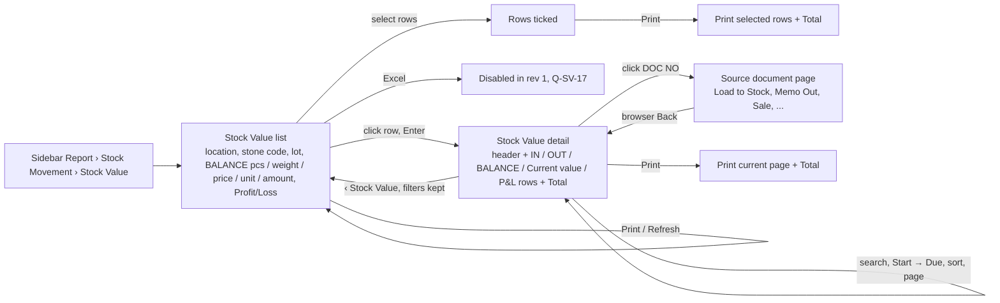
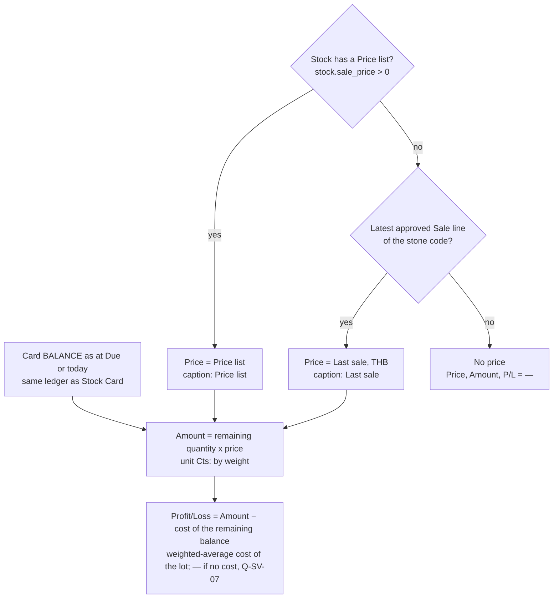

# Main flow: stock-value (UI revision 1)

Stock Value is a read-only report. The list shows, per stone code + location + lot, the BALANCE (Pcs, Weight) valued at the **current price** (Price with its source, Unit, Amount) and a Profit/Loss; a row opens the card's transactions (IN, OUT, running BALANCE, Current value, Profit & Loss, totals); a document number opens the source document. It uses the same cards and ledger as [Stock Card](stock-card-flow.md). Dashed edges and unknown transitions are open questions. SA refines the service side in its own sequence diagram without duplicating this flow.

Where the numbers come from (assumption, SA decides, [handoff](../coordination/handoffs/stock-value-sa.md)):

Open transitions: Q-SV-01…04 (price of a multi-stock card, price list, last sale, units), Q-SV-06 (Due date and current prices), Q-SV-07 / 09 / 10 (Profit/Loss), Q-SV-17 (Excel) in [open questions](../apps/frontend/stock-value/open-questions.md). UI: [ui-spec](../apps/frontend/stock-value/ui-spec.md).
