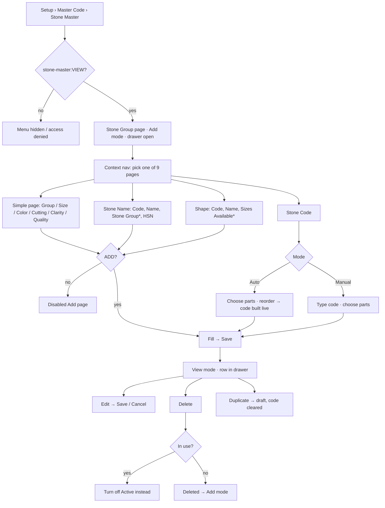

# Main flow: stone-master (UI revision 1, pending-review)

Source: [ui-spec](../apps/frontend/stone-master/ui-spec.md). SA refines the service interactions in its sequence diagram and does not duplicate this flow.

Open transitions: running-number codes (Q-SM-01) and per-page permissions (Q-SM-04) would change nodes F and B.
