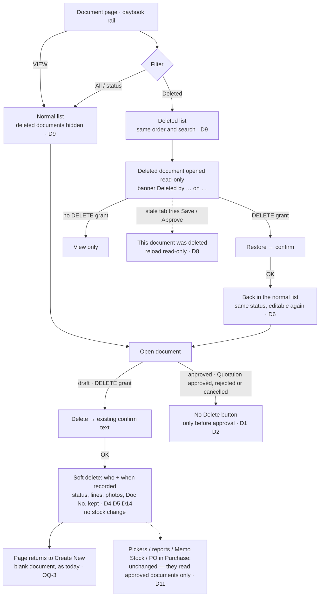

# Main flow: transaction soft delete (SA revision 1, 2026-11-06, approved 2026-11-06)

This applies to Quotation, Reserve, Memo Receive, Memo Return, Memo Out, Memo Out Return, Purchase Order and Purchase. Load to Stock, Merge/Split, Stock Transfer Location, Stock Adjustment and Sale follow the same flow when they are built ([ADR-0045](../adr/0045-transaction-document-soft-delete.md) D16). Service design: [decisions](../apps/backend/master/transaction-soft-delete/decisions.md), [sequences](../apps/backend/master/transaction-soft-delete/sequence-diagram.md). TODO: [transaction-soft-delete](../task/todo/transaction-soft-delete.md).

Nodes marked **(Dn)** are SA defaults the owner may change.

