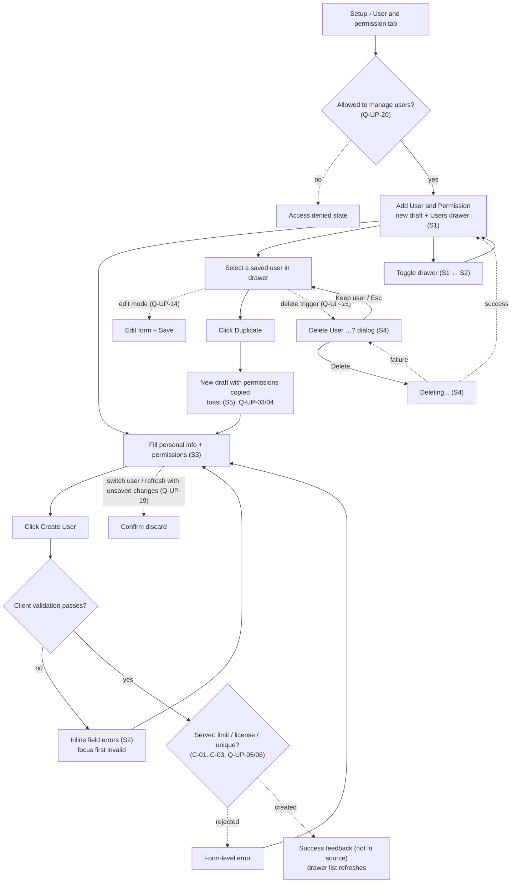

# User and permission flow

- **Feature / UI revision:** `user-permission` / 1 (pending-review)
- **Source:** [UI spec](../apps/frontend/user-permission/ui-spec.md), screenshots in [source/](../apps/frontend/user-permission/source/)
- **Last updated:** 2026-10-12

This is the main user flow taken from the screenshots. Dashed edges are transitions the screenshots do not
show; they are labeled with their open question ([open-questions.md](../apps/frontend/user-permission/open-questions.md)).
SA refines the service interactions in its own bundle and does not duplicate this flow.
Service sequences (SA revision 1, pending-review): [auth + gateway sequence diagrams](../apps/backend/auth/user-permission/sequence-diagram.md).
Proposed answers to the dashed-edge questions: [SA decisions](../apps/backend/auth/user-permission/decisions.md).

