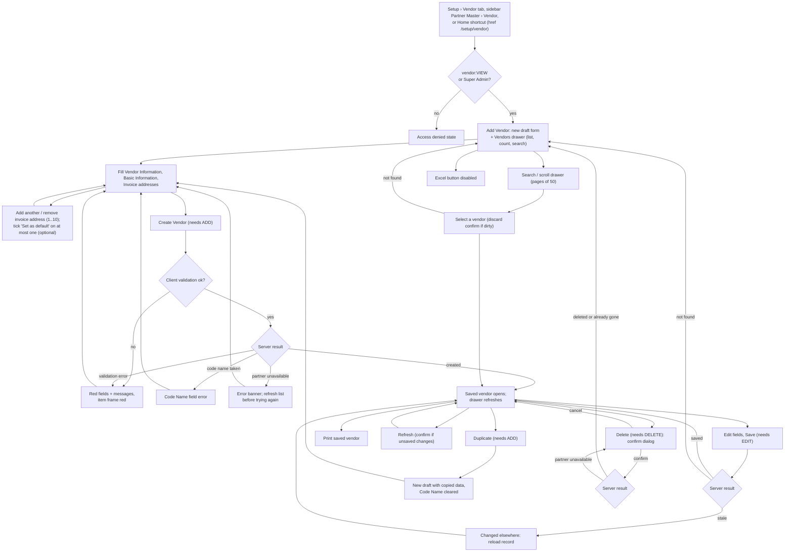

# Vendor flow

- **Feature / UI revision / SA revision:** `vendor` / 2 (approved 2026-10-15) / 1 (**pending-review**)
- **Source:** screenshots in [source/](../apps/frontend/vendor/source/); UI spec [vendor/ui-spec.md](../apps/frontend/vendor/ui-spec.md); pattern [customer-flow.md](customer-flow.md)
- **Service design:** [ADR-0019](../adr/0019-vendor-master.md) (Proposed), [SA bundle](../apps/backend/partner/vendor/architecture.md); service interactions are drawn only in the [vendor sequence diagrams](../apps/backend/partner/vendor/sequence-diagram.md)
- **Last updated:** 2026-10-15 (SA revision 1 refinement)

Main user flow for Setup › Vendor (`/setup/vendor`). Written by ui-spec from the screenshots and the approved
customer flow; refined by SA with the owner's answers (Q-VEN-02 phone optional, Q-VEN-03 default address optional)
and the service-level notes below.

## Service-level notes (SA revision 1)

| Flow step | Operation (gateway tRPC → partner) | Permission | Server rule / result | Sequence |
|---|---|---|---|---|
| Page guard | `permission.mine` (existing) | licensed session | no `vendor.*` call without `vendor:VIEW` | [1](../apps/backend/partner/vendor/sequence-diagram.md#1-page-load-context-permission-list-and-options) |
| Drawer, search, paging | `vendor.list` → `GET /internal/v1/vendors` | `vendor:VIEW` | contains-match on Name or Code Name; 50 per page; total | [1](../apps/backend/partner/vendor/sequence-diagram.md#1-page-load-context-permission-list-and-options), [2](../apps/backend/partner/vendor/sequence-diagram.md#2-search-page-and-open-a-vendor) |
| Currency / Country lists | `vendor.options` → `GET /internal/v1/vendors/options` | `vendor:VIEW` | same lists as Customer, fetched once | 1 |
| Select a vendor | `vendor.get` | `vendor:VIEW` | `VENDOR_NOT_FOUND` → back to draft | 2 |
| Create Vendor | `vendor.create` | `vendor:ADD` | 1–10 invoice addresses; **0 or 1 default, none is valid and nothing is auto-selected**; Code Name unique among vendors (`VENDOR_CODE_TAKEN`) | [3](../apps/backend/partner/vendor/sequence-diagram.md#3-create-vendor-default-optional) |
| Save | `vendor.update` (full replacement, `expectedUpdatedAt`) | `vendor:EDIT` | `VENDOR_STALE` → reload; `VENDOR_NOT_FOUND` → deleted elsewhere | [4](../apps/backend/partner/vendor/sequence-diagram.md#4-update-vendor-whole-replacement-optimistic-concurrency) |
| Delete | `vendor.delete` | `vendor:DELETE` | permanent, addresses removed; repeat → already deleted. Future purchase documents keep their own copy of vendor data | [5](../apps/backend/partner/vendor/sequence-diagram.md#5-delete-vendor-hard) |
| Partner unavailable | any | — | `PARTNER_UNAVAILABLE`; mutations never retried automatically | [6](../apps/backend/partner/vendor/sequence-diagram.md#6-partner-unavailable-timeout-or-token-mismatch) |
| Duplicate, Print, Refresh, Excel | client only (Refresh re-runs `list`/`get`) | ADD / VIEW / VIEW / — | no new operation | — |
