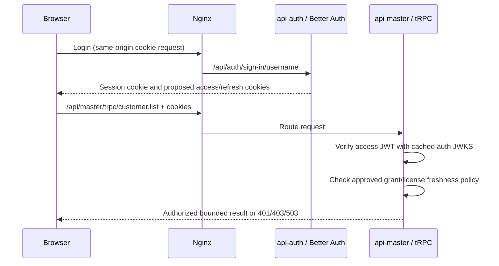

# SA feasibility review: retain tRPC and Better Auth under GMS Platform Spec v1.1

- **Review revision:** 1; **status:** feasibility assessment, pending owner architecture decision
- **Date:** 2026-10-20 (Asia/Bangkok)
- **Question:** Can the existing tRPC and Better Auth choices survive the target architecture in [`gms-platform-spec.md`](../../gms-platform-spec.md)?
- **Scope:** architecture comparison only. No UI feature/revision is selected; this is not an implementation bundle or an approval for topology, contracts, schema, packages, migrations, or deployment.

## Answer

**Yes, both libraries can remain, but the current wiring cannot meet the spec unchanged.** tRPC is a transport/router library that can run inside a domain HTTP service; it does not require a separate gateway. Better Auth can remain the login and session authority in `api-auth`; its existing opaque session cookie is **not** the spec's locally verifiable access JWT. A separately issued, asymmetric JWT and a deliberately designed refresh/revocation protocol are needed if the spec's local JWT verification and rotating refresh-token rules remain mandatory.

This answer is based on the actual checkout, not an assertion that the new topology or token plugin has been implemented. `backend-api-auth` and `frontend` lock Better Auth **1.7.7**; gateway/client lock tRPC **11.19.0**. The installed Better Auth 1.7.7 package includes the JWT plugin types (`plugins/jwt/types.d.mts`), including `jwks`, `expirationTime`, and `definePayload`; current official documentation describes the plugin's distinct `/token` and `/jwks` endpoints. The exact selected version and integration still require a contract/prototype before implementation.

## Evidence and conflicts

| Concern | Existing accepted design / code | GMS v1.1 target | Consequence |
|---|---|---|---|
| Public routing | [ADR-0007](../../adr/0007-trpc-procedure.md) requires all app data through tRPC. Next `/api/trpc` route proxies to the NestJS gateway; the gateway mounts an Express tRPC router at `/trpc` (`frontend/src/app/api/trpc/[...path]/route.ts`, `backend-api-gateway/src/main.ts`). | §2: Nginx is sole public ingress; no Node API gateway; `/api/auth`, `/api/master`, `/api/inventory` route to domain APIs. §14 reserves Next handlers for `/bff/`. | Existing route and gateway contradict the target. Keeping tRPC does not require keeping the gateway. Hiding an internal API URL is not an authorization control. |
| Identity | [ADR-0008](../../adr/0008-use-better-auth.md) selects Better Auth. `backend-api-auth/src/auth/auth.ts` stores database sessions, uses Argon2id, username login, and a SameSite=Lax httpOnly session cookie. | §7: 15-minute RS256/EdDSA access JWT, rotating 7–30-day refresh token, services verify locally against auth's public key. | Better Auth session ID cannot simply be relabeled as a JWT. The JWT plugin can sign separate JWKS-verifiable tokens; session/refresh semantics need design. |
| Enforcement | [ADR-0016](../../adr/0016-per-user-menu-action-permissions.md) requires uncached per-request grants, effective on next request. Gateway `request-context.ts` calls auth `/internal/v1/session-context` each request to get session, live grants and license. `permittedProcedure` enforces them centrally. Partner currently trusts a static service token and actor ID, not a user JWT. | §2: each service validates the access JWT locally; no per-request auth call. | A 15-minute token containing grants/license permits stale access until expiry. Local cryptographic verification alone cannot satisfy next-request revocation. Moving the router changes who must enforce grants, license and price masking. |
| Service ownership | [ADR-0018](../../adr/0018-customer-master-partner-service.md) and [ADR-0024 Stone Master](../../adr/0024-stone-master-in-partner-service.md) assign customer/vendor and stone data to `backend-api-partner` with internal REST, partner/stone schemas. | §2 calls the general master domain `api-master` and puts stock-tied items in `api-inventory`; one schema and DB role per service. | Renaming/repartitioning is a separate migration decision; retaining tRPC/Better Auth does not authorize it. Two files numbered ADR-0024 also exist; resolve numbering in any new ADR. |
| Frontend/CSRF | Frontend uses `httpBatchLink('/api/trpc')` with cookies; Next also proxies `/api/auth` and `/api/v1`. Better Auth has `trustedOrigins` and SameSite cookies. | §14: browser relative same-origin `/api/...`, token cookies httpOnly/Secure/Lax, state-changing requests carry CSRF token or required custom header; SSR calls APIs over Docker network. | Nginx routing and cookie scope can support one origin, but all mutation routes need explicit CSRF control. Avoid a bearer-access token readable by browser JavaScript if the chosen design keeps tokens in httpOnly cookies. |
| Budget | [ADR-0024 production](../../adr/0024-production-host-4gb-2vcpu.md) and [capacity](../../infra/capacity.md): current five-container limits total 2944 MiB / 1.70 vCPU; production load is not yet measured. | §3/§11 add Nginx, Redis, worker and inventory within 4 GB / 2 vCPU, with host headroom. | No spare capacity is proved for additive containers; merely retaining a gateway adds pressure. Recalculate *one complete* Compose profile and test production images before claiming fit. |

## Option A — private tRPC gateway behind Nginx

`browser → Nginx /api/trpc → gateway → auth/master`; Better Auth remains in `api-auth`. Nginx alone publishes ports; the gateway remains private. This is the smallest tRPC routing migration and preserves the current shared `AppRouter`, frontend hooks and central permission middleware. Nginx can route `/api/auth/` to `api-auth`, while legacy `/api/trpc` goes to gateway. SSR should use an internal address rather than round-trip through the public host.

**Fit:** technically feasible but expressly violates §2's **“There is no Node.js API gateway.”** It needs a written, owner-approved exception or a time-boxed transition. Keeping the current per-request auth `session-context` check also violates local verification/no auth call. Replacing that check with JWT validation while leaving the gateway as sole enforcer does **not** satisfy “each service verifies tokens itself”; partner would still trust gateway's service token/actor header. Nginx topology, Next proxy removal, URL/cookie origin, JWT issuance/verification, forwarding and permission semantics all require code/config/contract changes, not configuration alone.

**Capacity:** the current gateway cap is 384 MiB / 0.25 vCPU. The spec's inventory (256 MiB), worker (512 MiB), Redis (192 MiB) and Nginx (32 MiB) add **992 MiB** of limits. Adding them to today's 2944 MiB without other changes would total **3936 MiB**, leaving about **160 MiB** of a 4096 MiB host before OS/Docker needs. Removing only the gateway would still total **3552 MiB**, with about **544 MiB** left. These are illustrative caps, not workload measurements: the spec also proposes lower frontend/auth limits and different service composition, so infra must model and measure the complete profile. A private gateway can be a bounded interim compatibility layer only after that revised budget.

## Option B — domain-hosted tRPC, no dedicated gateway

`browser → Nginx /api/auth/trpc → api-auth` and `browser → Nginx /api/master/trpc → api-master`; inventory can expose its own tRPC adapter or REST contract by an explicit ADR choice. tRPC [v11 adapters](https://trpc.io/docs/server/adapters) support Express and Fetch hosts, so domain NestJS APIs can host tRPC without a gateway. `api-auth` remains the Better Auth owner and JWT issuer; each domain API verifies the access JWT and enforces its own actions and license/price rules. The frontend uses distinct typed clients or a reorganized shared contract package, with bounded pagination and SSR using internal service URLs. The existing `partner` service must be mapped or migrated to the approved `master` boundary separately.

**Fit:** best long-term match for §2 while preserving the two libraries, with a material migration cost. Splitting `AppRouter` moves `permittedProcedure`, input/output schemas, error mapping, request limits, authorization, and internal service calls into domain-owned boundaries. `frontend` currently imports `AppRouter` from the gateway workspace, so client types and hooks must change. A Next `/bff/trpc` route could host the shared router, but it would reproduce a Node gateway inside the frontend and add a web-server hop; it is only an explicit BFF exception for narrow orchestration, not a compliant drop-in replacement for the domain APIs. §14 permits `/bff/` route handlers, but their authorization and memory cost still require an ADR.

**Recommendation:** retain tRPC as an app-data transport and Better Auth as the credential/session authority; target domain-hosted tRPC (B) and avoid a permanent gateway. If preserving current screens while migrating is necessary, approve A as a **temporary, explicitly scoped exception** with a removal gate. No code migration should begin from this review alone.

## Token, permission and failure contract that the SA bundle must settle

1. **Token distinction.** Better Auth's main session cookie remains an opaque database session identifier; the [JWT plugin](https://better-auth.com/docs/plugins/jwt) issues separate JWKS-verifiable tokens and explicitly says they are not a replacement for sessions. The session cookie cache JWT is not automatically the same public-key access token. Pin signing algorithm (`EdDSA` or `RS256`), `iss`, `aud`, `sub`, `iat`, `exp ≤ 15 min`, `kid`, and key publication/rotation. Never accept the license-server's signed license JWT as a user access JWT; its trust boundary and claims differ.
2. **Refresh.** Calling Better Auth `/token` from an existing session can mint a new access JWT, but a sliding opaque session is not automatically a **rotating refresh token with 7–30-day lifetime**. Choose either (a) a dedicated hashed, one-time refresh credential with reuse detection, family revocation and its own auth schema/endpoint, or (b) an explicit spec exception that treats renewed Better Auth sessions as the user-facing refresh mechanism. Specify concurrent tabs, expiry, stolen-token handling, logout, password change, single-session rule, and how cookies are cleared.
3. **Immediate revocation.** ADR-0016's next-request permission changes, login deactivation, and license revocation cannot be guaranteed by a self-contained 15-minute JWT alone. Owner/SA must choose a bound: preserve next-request enforcement with a small online check for sensitive actions (exception to §2), accept up to token TTL latency (revision to ADR-0016/license behavior), or design a bounded per-service revocation/version feed with defined failure policy and measured cache cost. A feed requires propagation, durability, reconnect and key/version invalidation rules; calling it “local verification” does not by itself solve stale grants. Until decided, fail closed for missing/invalid/expired JWT and license uncertainty; do not mark this as compatible with existing grant semantics.
4. **Authorization per service.** JWT verification checks signature, algorithm allowlist, issuer, audience, expiry/not-before and key ID; each service must then check current account/license and exact `menuKey:action`, including `PRICE` masking, and record actor ID from validated claims. The current partner static token + `X-Actor-User-Id` is service authentication only and cannot stand in for per-user authorization. Preserve internal service authentication separately. Return consistent 401 (no/invalid credential), 403 (grant/license denied), and 503/defined fail-closed response for unavailable critical authorization evidence. Do not retry non-idempotent mutations automatically.
5. **Cookie and CSRF.** Keep browser on the Nginx origin; set host-only `Secure`, `HttpOnly`, `SameSite=Lax` cookies with route/path rules that actually reach the selected API. Require CSRF token or an enforced non-simple custom header on every state-changing cookie-authenticated API route, including tRPC mutations, REST uploads, auth/refresh/logout; verify `Origin`/Fetch Metadata at the trusted boundary. Better Auth's [security protections](https://better-auth.com/docs/reference/security) cover its own endpoints, not automatically custom NestJS/tRPC handlers. Bound batching/body sizes and block state changes over GET.
6. **SSR.** Next server fetches internal APIs with the user's incoming cookie or short-lived token; it must forward `Set-Cookie` on refresh to the browser and must not cache personalized responses across users. Browser uses relative public URLs. Move Next's existing `/api/auth`, `/api/trpc`, `/api/v1` proxy routes only after Nginx/API routing and cookie flow are verified; §14 reserves Next handlers for `/bff/`.
7. **JWKS failure/key rotation.** Each verifier keeps a small bounded key cache, refreshes on unknown `kid` with throttling, and rejects unknown keys/invalid signatures. Auth outage must not silently turn authentication into permissive access. Define max JWKS staleness and overlap/grace for rotation; measure crypto and request p95 on the 4 GB/2 vCPU host.

Illustrative target request path (token issuance/refresh and revocation policy remain design decisions):

## Required owner decisions and next SA work

| Decision | Existing agreement affected | Proposed default for a future bundle |
|---|---|---|
| End-state transport topology, and whether gateway exception is permitted during migration | GMS §2 vs ADR-0007, [tech-stack](../../adr/tech-stack.md), current gateway/Next proxy | Domain-hosted tRPC; temporary private gateway only with explicit sunset and capacity evidence. |
| Auth refresh and JWT integration | GMS §7/§14 vs ADR-0008 and Better Auth session implementation | Keep Better Auth login/session; design separate public-key access JWT and rotating refresh protocol, unless owner amends the refresh rule. |
| Revocation and license freshness bound | GMS §2 local verification vs ADR-0016 next-request grants, auth/license rules | Preserve next-request behavior for privileged mutations until owner explicitly accepts a weaker bound or an event/online-check design. |
| Domain and schema placement | GMS `api-master`/`api-inventory` vs accepted ADR-0018/Stone Master placement | Separate service/data migration ADR, with no automatic rename or cross-schema write. |
| Full resource profile | GMS §3/§11 vs ADR-0024 current 2944 MiB/1.70 vCPU | Infra models production Compose, DB pools, worker/Redis/Nginx/inventory, and measures actual production images. |

After those choices, SA must write a proposed architecture ADR (allocate next **unique** number), revise affected accepted ADRs/tech-stack, and create the complete `document/apps/backend/<service>/<feature>/` service templates including editable sequence/ER diagrams, API and error contracts, authorization, dependencies, test/rollout/rollback plans and central TODOs. Route any selected container changes to infra and build/release changes to devops through the parent. Present that **separate complete SA bundle** for owner approval before code, migration, wiring or package installation. No selected frontend UI revision exists for this review.

## Primary references

- [tRPC v11 adapter overview](https://trpc.io/docs/server/adapters): supported Express and Fetch hosts.
- [Better Auth JWT plugin](https://better-auth.com/docs/plugins/jwt): separate JWT/JWKS endpoints, signing/claims and schema; plugin is not a session replacement.
- [Better Auth session management](https://better-auth.com/docs/concepts/session-management) and [cookies](https://better-auth.com/docs/concepts/cookies): primary opaque cookie, session lifetime and revocation.
- [Better Auth security](https://better-auth.com/docs/reference/security): auth endpoint CSRF/trusted-origin behavior.
